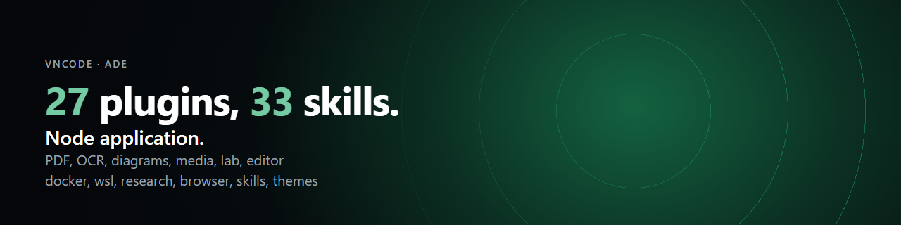

<div align="center">

<picture>
  <source media="(prefers-color-scheme: dark)" srcset="assets/logo/vn-code-white-512.png">
  
</picture>

<br>

# vn-code

<p>
       
</p>

<p>
  Agent-Human ADE ⌨️<br>
  Bundles <a href="packages/">Plugins</a>, <a href="docs/">Skills</a> and <a href="docs/">Interfaces</a>
</p>

</div>



Cross-platform Node ADE with core [DSH](https://www.deepseek.com/harness/en/) for professional Engineering and Design: every plugin is **Node.js** (plain JavaScript bundles, zero npm dependencies), while **Rust** is only the small front-door installer binary that composes the harness home and runs the launcher. The launchers run on **Windows, macOS and Linux**.


## Run

| | Windows | macOS / Linux |
|---|---|---|
| **The app** | `scripts\run-desktop.bat` | `./scripts/run-desktop.sh` |
| **Browser tab only** | `scripts\run-web.bat` | `./scripts/run-web.sh` |

`run-web` starts the pinned harness and opens the URL it prints in Chrome, falling back to
your default browser. `run-desktop` builds `vncode` when there is none and runs it: it
installs the pack if the home in use lacks it, asks for the DeepSeek key if there is none,
and then runs that same `run-web` in the foreground.

`vncode` is a small Rust binary - about **0.5 MB per OS** - with **no window and no embedded
browser**: the interface is the same web application, in the browser you already use. Its
verbs are `start` (the default), `install`, `uninstall`, `status` and `key`; `-Help` lists
the flags, and [`app/README.md`](app/README.md) is the whole app on one page.

```sh
cd app
cargo build --release --locked          # -> app/target/release/vncode (~0.5 MB)
./target/release/vncode status          # the pin, the home, the pack, the key, the launcher
./target/release/vncode                 # install if needed, key if needed, then run-web
./target/release/vncode key             # write DEEPSEEK_API_KEY into <home>/.env
./target/release/vncode -Help           # every verb and flag
```

`vncode` never runs node itself: it starts `scripts/run-web.*`, which does. Nothing it does
needs a window, a port or a browser of its own.

The URL is opened only when it names a **loopback** address, and the launch token is never
written to a file - both rules are in [SECURITY.md](SECURITY.md).

## Plugins

Every package's own README is the reference for what it does, why it is built that
way and what it touches. The exact versions are in
[`.dsh-version.json`](.dsh-version.json).

| Package | What it adds |
|---|---|
| [`dsh-vn-master`](packages/dsh-vn-master/README.md) | the browser-free master, installed **last** - the slot pack-wide patches and row restatements go in (it enables the Browser tab on the web profile, and removes the feedback surface) |
| [`dsh-rightbar`](packages/dsh-rightbar/README.md) | the pack's own right bar: tab strip, docking panel and the `sidebarRight` registry (a fork of the shipped bar) |
| [`dsh-rightbar-files`](packages/dsh-rightbar-files/README.md) | the Files tab type on top of that bar |
| [`dsh-editor`](packages/dsh-editor/README.md) | text and code tabs (vendored CodeMirror 6), with a Markdown preview and Save/Create |
| [`dsh-gittree`](packages/dsh-gittree/README.md) | **read-only** History tab: the workspace's commits as a graph rail (lanes, merges, PR chips), and the files each one touched |
| [`dsh-image`](packages/dsh-image/README.md) | an image viewer that fits, zooms, pans, and reads the source pixel under the pointer |
| [`dsh-audio`](packages/dsh-audio/README.md) | a waveform surface: WAV/AIFF/FLAC, one track per channel, dBFS, selection and playback |
| [`dsh-media`](packages/dsh-media/README.md) | media the agent can work with: `media_probe` / `media_run` / `media_frames` over a **pinned, SHA-256-verified** ffmpeg copy, plus the routes the video tab streams through |
| [`dsh-supercollider`](packages/dsh-supercollider/README.md) | SuperCollider the agent can **play**: ten `sc_*` tools over one long-lived `sclang` session (a warm round trip is ~31 ms, and what the agent defines is still there next call) and a hand-written OSC client to `scsynth`, the installed `.schelp` reference indexed for `sc_help`, the `.scd` file workflow, and **five skills** that teach the language, SynthDefs and live coding — every code example in them compiled by a check. Zero npm dependencies and nothing bundled — it finds the machine's own SuperCollider — and its own UI is one small console tab, with `.scd` files opening in the editor |
| [`dsh-video`](packages/dsh-video/README.md) | a player tab that streams and seeks any video container, with an ffprobe facts panel, chapter jumps and a one-click remux when the browser cannot decode it |
| [`dsh-diagrams`](packages/dsh-diagrams/README.md) | Mermaid, TikZ **and the Diagram Design kit** as tabs *and* seven agent tools — the kit's 204 examples and 44 documented types are vendored at a pinned commit, browsable on the index page, insertable in one call, and every write (a self-contained HTML document included) is validated before it is stored |
| [`dsh-frontend-craft`](packages/dsh-frontend-craft/README.md) | front-end design craft: **Impeccable's** Apache-2.0 corpus vendored at a pinned commit — 24 commands, 41 references, the craft floor, the four visitor modes and the native platform references — plus its **61-rule detector built to WebAssembly inside the package**, so there is no `npx impeccable`, no engine download and no network. Five `fe_*` tools (`fe_context`, `fe_detect`, `fe_direction`, `fe_artifact`, and `fe_render`, which renders a workspace HTML file or a loopback dev-server URL in the machine's own headless Chrome/Edge and measures contrast, tap targets, overflow, line length, type size, heading order and missing alt), an 18-world local direction deck so the roll always carries a challenger the agent did not write, and a **Frontend** tab with findings, artifacts, the direction round and the rendered picture. The detector's findings match the upstream CLI **186/186** on its own fixtures |
| [`dsh-shaders`](packages/dsh-shaders/README.md) | **GLSL that compiles for real**: seven `shader_*` tools drive the browser this machine already has — argv-only, throwaway profile, every name resolved to `NOTFOUND` — and every answer names the rung it **actually reached** (`v1-static` → `v2-compiled` → `v3-drawn` → `v4-measured`), with each diagnostic mapped back onto *your* line numbers and the active uniforms read out of the linked program. Five dialects are kept apart because they are not interchangeable, and **desktop GLSL is refused rather than faked** (ANGLE cannot compile it). `shader_target` emits a standalone web page, a `.frag`+`.vert` pair, **ISF** (which Resolume reads), a FreeFrameGL C++ **scaffold** — never a build, FFGL is a C++ ABI — or Shadertoy names. The corpus is 3.1 MB of pinned MIT shaders: **106 Radiant pages with 79 extracted fragment sources**, **20 reusable GLSL modules, 11 templates, 11 finished pieces and 14 written references** from `shader-skills`, and a 48-link curated index; every byte re-derives **offline** (`vendor/*/build.mjs --check`). A **Shaders** tab draws the live WebGL preview with one slider per `@param`, five skills teach the language and the triage order, and the checks compile **every fragment in both corpora** and draw every finished piece |
| [`dsh-pdf`](packages/dsh-pdf/README.md) | PDF as a surface the agent can read and **scan**, plus a reader tab with thumbnails and bookmarks |
| [`dsh-ocr`](packages/dsh-ocr/README.md) | the agent can read a **picture**: one `ocr` tool over `tesseract` from PATH or — on Windows, with **nothing installed at all** — the OCR engine Windows ships, which rasterizes a PDF page itself. Names the engine, the language and the page count, refuses a language this host has no data for with the list of what it CAN read, and says every answer is a transcription |
| [`dsh-wsl`](packages/dsh-wsl/README.md) | the **POSIX half of this pack, testable on Windows**: `wsl_status` (the launcher's table decoded from UTF-16, the default distribution marked, and with `probe` whether a distribution can actually run a check), `wsl_run` (one **argv array** in a distribution — no shell string — with a deadline, a tree kill, a 1 MB cap per stream and the exit code in the answer) and `wsl_path` (`C:\…` ⇄ `/mnt/c/…`). It exists so `run-web.sh`, `install.sh` and the `sh` branches of the checks run on the machine that writes them; the launcher's default on a Docker machine is `docker-desktop-data`, so the tools name the distribution they used |
| [`dsh-docker`](packages/dsh-docker/README.md) | **Docker (or Podman) as a surface**: nine `docker_*` tools over the machine's own CLI — state, containers, images, inspect, logs, pull, run, lifecycle and a `docker_start` that launches **Docker Desktop** (or a `podman machine`) and waits for its **daemon** — plus a Docker tab listing containers and images with start/stop/remove, pull and run. argv-only, no shell, every removal confirmed by repeating the target, and no spelling for `exec`, `system prune` or `--privileged`. A Docker Desktop that is closed is the normal state on Windows 11: the answer says so and offers the button |
| [`dsh-ollama`](packages/dsh-ollama/README.md) | **Ollama as a measured surface**: five `ollama_*` tools over the machine's own daemon — status (the models on disk, what is **loaded** right now, and `ollama serve` when nothing answers), **one bounded inference** with the token counts and nanosecond durations Ollama reports and nothing in the pack used to read, a **benchmark that refuses fewer than 3 runs** and reports a median with spread (cold vs warm stated at the *first token*, because a cold load never lowers tok/s), A/B and `num_ctx` sweeps, models with pull/delete confirmed by repeating the tag, embeddings with cosine similarity — plus **three skills** (the REST API, the metric arithmetic, the Python client) whose examples a check parses, and a **loopback fence** that refuses a daemon on another machine before any request. A daemon that is down is an answer, not a failure |
| [`dsh-proto-lab`](packages/dsh-proto-lab/README.md) | a **prototyping lab** the agent fills: five `lab_*` tools write a run into the workspace's own `<workspace>/lab/<runtime>/<slug>/` — p5.js sketches a browser opens, and openFrameworks projects that are three real C++ files (`src/main.cpp`, `src/ofApp.h`, `src/ofApp.cpp`) built with your own projectGenerator and `make`. A **runtime registry** makes a third language one module and one line (Processing in Rust, Cinder), a committed example library sits beside each skill and is driven by the checks, and verification is an explicit ladder — structure, parse, compile, render, measure — whose answer always names the tier that was actually reached. The lab itself is **gitignored**: the bundle ships the generator and the examples, never the runs |
| [`dsh-research`](packages/dsh-research/README.md) | research as a **folder you keep**: your instruction and every gate answer recorded **in your own words**, nine `rs_*` tools over an append-only claim and source ledger — `rs_write` refuses until *you* confirm the question, and a claim's quote is checked against its source. Numbers are data (`p = .000` refused), a **method record**'s screening counts cannot increase, and a **disclosure record** must be *complete* — authors, ethics, funding, conflicts, data, AI use — before the submission folder prints it beside the title page, never in the manuscript a reviewer sees. `rs_verify action=calibrate` **measures the reader**, and the tab is rendered and measured in a real browser. Eight skills, an editable tab, no socket, no child process, nothing vendored |
| [`dsh-browser`](packages/dsh-browser/README.md) | the **Browser** tab, replacing the shipped iframe one: the page is rendered on the host in a disposable engine behind an https-only egress gate (screenshot, post-script text, measured styles) for the tab and for `browser_render` / `browser_query` / `browser_text` — **built and shipped, but turned OFF**: the master layer disables the row, so a profile loads no tab, no routes, no tools and no client bundle |
| [`dsh-skills`](packages/dsh-skills/README.md) | the **Skills browser**: a header button left of the zoom control opens every skill this conversation loads, with its markdown and inline editing |
| [`dsh-cmdbar`](packages/dsh-cmdbar/README.md) | the **command bar**: the agent's own commands in a bottom dock (a read-only transcript of the conversation's log — the terminals were removed in alpha.12; the panel follows whichever conversation is on screen) |
| [`dsh-themes`](packages/dsh-themes/README.md) | header controls (themes incl. Nord/Monokai/Hacker/Cyber, screenshot, page zoom), the Markdown paper, VN branding, and the shipped account-menu Feedback row hidden |
| [`dsh-ui-state`](packages/dsh-ui-state/README.md) | the pack's own UI state (zoom, theme, dock, column widths) remembered host-side |
| [`dsh-modal`](packages/dsh-modal/README.md) | the shared dialog surface (`modals`) the pack's controls use |
| [`dsh-open-in-app`](packages/dsh-open-in-app/README.md) | *Open In…* patched to open the OS file browser directly |

The pack used to ship its own Files panel (`dsh-files`, earlier `dsh-focus`); that
was retired when the harness grew a real right Sidebar, and the installer prunes
the old names so an upgrade cannot double-mount.

## Third-party content the pack vendors

Some bundles carry somebody else's work inside them. Nothing is fetched at run
time — the profile installs a bundle as a live link, so an engine the plugin needs
on both sides of the app has to be on disk — and every vendored tree keeps its
upstream `LICENSE` beside its bytes.

| what | bundles | how it is kept honest |
|---|---|---|
| **Mermaid** 11.17.2 (`lib/vendor/mermaid.min.js`) | `dsh-diagrams` | `node packages/dsh-diagrams/vendor/build.mjs --check` re-hashes the recorded sha256 |
| **Diagram Design** — 204 worked examples, 44 documented visual types, 62 reference documents, MIT, [`cathrynlavery/diagram-design`](https://github.com/cathrynlavery/diagram-design) | `dsh-diagrams` | `node packages/dsh-diagrams/vendor/design/build.mjs --check` re-hashes the whole 277-file tree OFFLINE against a pinned commit |
| **pdf.js** 6.3.289 (`lib/vendor/pdf.min.mjs` + worker, cmaps, fonts, wasm) | `dsh-pdf` | `node packages/dsh-pdf/vendor/build.mjs --check`, per-file hashes plus a digest per tree |
| **Impeccable** 4.6.0 (`@2f46b7a`, Apache-2.0) — the 24-command skill corpus and 41 references, the 61-rule registry, and the detector built from the same `crates/core` + `crates/foundation` to `detect_bg.wasm` (4,558,054 bytes) + its CommonJS glue | `dsh-frontend-craft` | `node packages/dsh-frontend-craft/vendor/impeccable/build.mjs --check` re-hashes every vendored file offline against a pinned commit; the engine is built HERE from that pin (`build-engine.mjs`, 54 s cold) with its Apache `LICENSE` and `NOTICE.md` beside it, and `VERSION.json` records the four textual transforms as well as every byte |
| **Radiant** — 106 shader pages, 79 extracted fragment sources, MIT, [`pbakaus/radiant`](https://github.com/pbakaus/radiant) | `dsh-shaders` | `node packages/dsh-shaders/vendor/radiant/build.mjs --check` re-derives the catalogue from the committed pages OFFLINE; pages are byte-identical, and the two that are not statically extractable are named with the reason |
| **shader-skills** — 20 GLSL modules, 11 templates, 11 gallery pieces, 14 references, MIT, [`gokayfem/shader-skills`](https://github.com/gokayfem/shader-skills) | `dsh-shaders` | `node packages/dsh-shaders/vendor/shader-skills/build.mjs --check` re-derives the dependency closure offline, and the catalogue records which gallery piece proves each template |
| **awesome-glsl** — a 48-link curated index (**no shader code**), MIT, [`vanrez-nez/awesome-glsl`](https://github.com/vanrez-nez/awesome-glsl) | `dsh-shaders` | `node packages/dsh-shaders/vendor/glsl-links/build.mjs --check` proves `links.json` still matches the vendored markdown |
| **p5.js** 1.11.13 (`lib/vendor/p5.min.js`, LGPL-2.1) | `dsh-proto-lab` | `node packages/dsh-proto-lab/vendor/build.mjs --check` re-hashes the recorded bytes offline. 1.x on purpose: it is the last line with a self-contained classic-script browser build, which is what a run opened straight off the filesystem needs |
| **CodeMirror 6** (`lib/vendor/cm6.min.js`) and the forked shipped client bundles | `dsh-editor`, `dsh-rightbar`, `dsh-open-in-app` | the bundle's own version marker and the forked trees' hashes, both asserted by `scripts/checks/` |

A vendored tree names its pin in a `SOURCE.json`/`VERSION.json` and — where the
copy differs from upstream at all — says so in a `NOTICE.md`: the Diagram Design
kit is line-ending-normalized to LF so a Windows checkout cannot report phantom
drift, and that is the only change to it. A pin bump is deliberate — `--update-pin`,
rebuild, review the diff, run the package's own check.

## Security & license

- **AGPL-3.0-only** - see [LICENSE](LICENSE). Copyright (C) 2026 **vecnode**.
  The pack is copyleft: you may run, study, change and share it, and a version
  you **distribute or offer over a network** must carry its source under the same
  license. That is deliberate - vn-code is not to become a closed product on
  somebody else's bench. A commercial exception is available on request; see
  [CONTRIBUTING.md](CONTRIBUTING.md) for the CLA that keeps that possible, and
  [THIRD-PARTY-NOTICES.md](THIRD-PARTY-NOTICES.md) for the vendored trees that keep
  their own licenses (Apache-2.0, MIT, LGPL-2.1) and are **not** relicensed by this.
- [SECURITY.md](SECURITY.md): the threat model, the launch token, the code this pack
  runs on purpose (`dsh-supercollider`'s interpreter and its `eval` route among them),
  what the pack deliberately does not do, and how `check-no-secrets.mjs` keeps a
  credential out of a commit. Report a vulnerability privately, as described there.
- [ARCHITECTURE.md](ARCHITECTURE.md) is the deep dive; [docs/](docs) holds install,
  distribute, compatibility and per-host notes.
