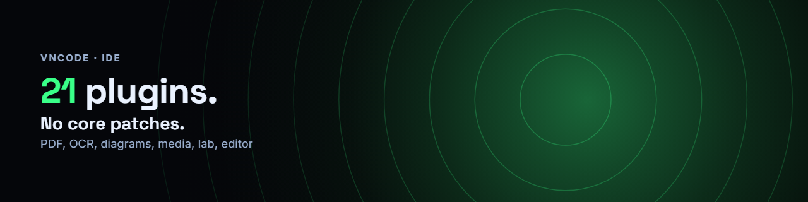
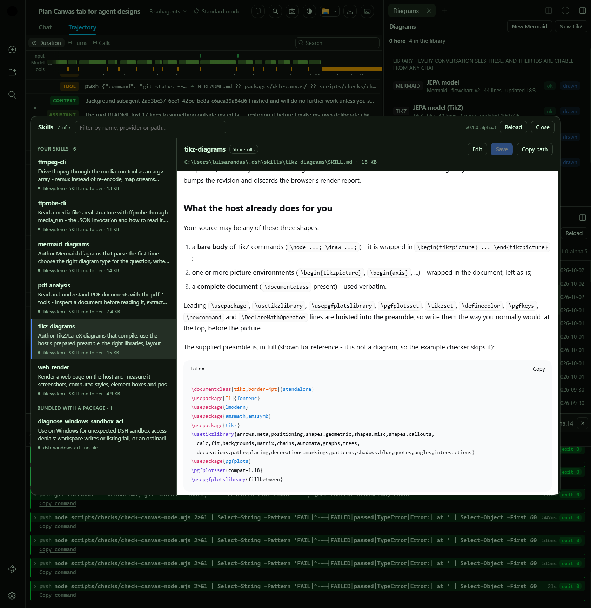

# 💻 vn-code


    

      

[](docs/PLAN-egui-shell.md)

Agent-Human IDE/ADE ⌨️    
Web and Desktop versions, bundles [`Plugins`](packages/),  [`Skills`](docs/) and [`Interfaces`](docs/)



Cross-platform IDE/ADE. Wraps core [DSH](https://www.deepseek.com/harness/en/) with Rust for professional Engineering and Design. Standard **dsh bundles** are plain JavaScript with **zero npm dependencies**; the launchers run on **Windows, macOS and Linux**.

<p align="left">
  
</p>

## Run

| | Windows | macOS / Linux |
|---|---|---|
| **Native window** | `scripts\run-desktop.bat` | `cargo build --release` in `app` |
| **Browser tab** | `scripts\run-web.bat` | `./scripts/run-web.sh` |

Both start the pinned harness and hand the URL it prints to a surface: `run-web` opens
it in Chrome, falling back to your default browser, and the native window does the same
unless it was built **with the pane**, in which case it draws the harness inside its own
window and starts no browser at all. The URL is opened only when it names a **loopback**
address, and the launch token is never written to a file - both rules are in
[SECURITY.md](SECURITY.md).

The native window is a Rust **egui** shell: a small control panel that opens first and
starts nothing, shows where everything lives, starts the pinned harness on **Start** (the
same launch path `run-web` uses), shows it in a browser it found or - with the pane - in a
`harness` tab of its own window, and ends the whole instance again on **Stop**. The plan it
was built from is [`docs/PLAN-egui-shell.md`](docs/PLAN-egui-shell.md), including the
**egui 0.36.2** line the badge above pins.

### Testing the compiled release, with the harness drawn inside the window

```sh
cd app
cargo build --release -p vn-shell --features pane
.\target\release\vncode.exe        # macOS / Linux: ./target/release/vncode
```

Press **Start**, then click the **harness** tab. The pane is **opt-in**: a plain
`cargo build --release` compiles no engine at all - which is exactly what
`scripts\run-desktop.bat` runs - and `scripts/checks/check-pane.mjs` is what proves the
two builds disagree.


## Plugins

Every package's own README is the reference for what it does, why it is built that
way and what it touches. The exact versions are in
[`.dsh-version.json`](.dsh-version.json).

| Package | What it adds |
|---|---|
| [`dsh-vn-master`](packages/dsh-vn-master/README.md) | the browser-free master, installed **last** - the slot pack-wide patches and row restatements go in (it enables the Browser tab on the web profile, and removes the feedback surface) |
| [`dsh-rightbar`](packages/dsh-rightbar/README.md) | the pack's own right bar: tab strip, docking panel and the `sidebarRight` registry (a fork of the shipped bar) |
| [`dsh-rightbar-files`](packages/dsh-rightbar-files/README.md) | the Files tab type on top of that bar |
| [`dsh-editor`](packages/dsh-editor/README.md) | text and code tabs (vendored CodeMirror 6), with a Markdown preview and Save/Create |
| [`dsh-gittree`](packages/dsh-gittree/README.md) | **read-only** History tab: the workspace's commits as a graph rail (lanes, merges, PR chips), and the files each one touched |
| [`dsh-image`](packages/dsh-image/README.md) | an image viewer that fits, zooms, pans, and reads the source pixel under the pointer |
| [`dsh-audio`](packages/dsh-audio/README.md) | a waveform surface: WAV/AIFF/FLAC, one track per channel, dBFS, selection and playback |
| [`dsh-media`](packages/dsh-media/README.md) | media the agent can work with: `media_probe` / `media_run` / `media_frames` over a **pinned, SHA-256-verified** ffmpeg copy, plus the routes the video tab streams through |
| [`dsh-supercollider`](packages/dsh-supercollider/README.md) | SuperCollider the agent can **play**: ten `sc_*` tools over one long-lived `sclang` session (a warm round trip is ~31 ms, and what the agent defines is still there next call) and a hand-written OSC client to `scsynth`, the installed `.schelp` reference indexed for `sc_help`, the `.scd` file workflow, and **five skills** that teach the language, SynthDefs and live coding — every code example in them compiled by a check. Zero npm dependencies and nothing bundled — it finds the machine's own SuperCollider — and its own UI is one small console tab, with `.scd` files opening in the editor |
| [`dsh-video`](packages/dsh-video/README.md) | a player tab that streams and seeks any video container, with an ffprobe facts panel, chapter jumps and a one-click remux when the browser cannot decode it |
| [`dsh-diagrams`](packages/dsh-diagrams/README.md) | Mermaid, TikZ **and the Diagram Design kit** as tabs *and* seven agent tools — the kit's 204 examples and 44 documented types are vendored at a pinned commit, browsable on the index page, insertable in one call, and every write (a self-contained HTML document included) is validated before it is stored |
| [`dsh-pdf`](packages/dsh-pdf/README.md) | PDF as a surface the agent can read and **scan**, plus a reader tab with thumbnails and bookmarks |
| [`dsh-ocr`](packages/dsh-ocr/README.md) | the agent can read a **picture**: one `ocr` tool over `tesseract` from PATH or — on Windows, with **nothing installed at all** — the OCR engine Windows ships, which rasterizes a PDF page itself. Names the engine, the language and the page count, refuses a language this host has no data for with the list of what it CAN read, and says every answer is a transcription |
| [`dsh-proto-lab`](packages/dsh-proto-lab/README.md) | a **prototyping lab** the agent fills: five `lab_*` tools write a run into the workspace's own `<workspace>/lab/<runtime>/<slug>/` — p5.js sketches a browser opens, and openFrameworks projects that are three real C++ files (`src/main.cpp`, `src/ofApp.h`, `src/ofApp.cpp`) built with your own projectGenerator and `make`. A **runtime registry** makes a third language one module and one line (Processing in Rust, Cinder), a committed example library sits beside each skill and is driven by the checks, and verification is an explicit ladder — structure, parse, compile, render, measure — whose answer always names the tier that was actually reached. The lab itself is **gitignored**: the bundle ships the generator and the examples, never the runs |
| [`dsh-research`](packages/dsh-research/README.md) | research as a **folder you keep**: your instruction and every gate answer recorded **in your own words**, nine `rs_*` tools over an append-only claim and source ledger — `rs_write` refuses until *you* confirm the question, and a claim's quote is checked against its source. Numbers are data (`p = .000` refused), a **method record**'s screening counts cannot increase, and a **disclosure record** must be *complete* — authors, ethics, funding, conflicts, data, AI use — before the submission folder prints it beside the title page, never in the manuscript a reviewer sees. `rs_verify action=calibrate` **measures the reader**, and the tab is rendered and measured in a real browser. Eight skills, an editable tab, no socket, no child process, nothing vendored |
| [`dsh-browser`](packages/dsh-browser/README.md) | the **Browser** tab, replacing the shipped iframe one: the page is rendered on the host in a disposable engine behind an https-only egress gate (screenshot, post-script text, measured styles) for the tab and for `browser_render` / `browser_query` / `browser_text` — **built and shipped, but turned OFF**: the master layer disables the row, so a profile loads no tab, no routes, no tools and no client bundle |
| [`dsh-skills`](packages/dsh-skills/README.md) | the **Skills browser**: a header button left of the zoom control opens every skill this conversation loads, with its markdown and inline editing |
| [`dsh-cmdbar`](packages/dsh-cmdbar/README.md) | the **command bar**: the agent's own commands in a bottom dock (a read-only transcript of the conversation's log — the terminals were removed in alpha.12; the panel follows whichever conversation is on screen) |
| [`dsh-themes`](packages/dsh-themes/README.md) | header controls (themes incl. Nord/Monokai/Hacker/Cyber, screenshot, page zoom), the Markdown paper, VN branding, and the shipped account-menu Feedback row hidden |
| [`dsh-ui-state`](packages/dsh-ui-state/README.md) | the pack's own UI state (zoom, theme, dock, column widths) remembered host-side |
| [`dsh-modal`](packages/dsh-modal/README.md) | the shared dialog surface (`modals`) the pack's controls use |
| [`dsh-open-in-app`](packages/dsh-open-in-app/README.md) | *Open In…* patched to open the OS file browser directly |

The pack used to ship its own Files panel (`dsh-files`, earlier `dsh-focus`); that
was retired when the harness grew a real right Sidebar, and the installer prunes
the old names so an upgrade cannot double-mount.

## Third-party content the pack vendors

Some bundles carry somebody else's work inside them. Nothing is fetched at run
time — the profile installs a bundle as a live link, so an engine the plugin needs
on both sides of the app has to be on disk — and every vendored tree keeps its
upstream `LICENSE` beside its bytes.

| what | bundles | how it is kept honest |
|---|---|---|
| **Mermaid** 11.17.2 (`lib/vendor/mermaid.min.js`) | `dsh-diagrams` | `node packages/dsh-diagrams/vendor/build.mjs --check` re-hashes the recorded sha256 |
| **Diagram Design** — 204 worked examples, 44 documented visual types, 62 reference documents, MIT, [`cathrynlavery/diagram-design`](https://github.com/cathrynlavery/diagram-design) | `dsh-diagrams` | `node packages/dsh-diagrams/vendor/design/build.mjs --check` re-hashes the whole 277-file tree OFFLINE against a pinned commit |
| **pdf.js** 6.3.289 (`lib/vendor/pdf.min.mjs` + worker, cmaps, fonts, wasm) | `dsh-pdf` | `node packages/dsh-pdf/vendor/build.mjs --check`, per-file hashes plus a digest per tree |
| **p5.js** 1.11.13 (`lib/vendor/p5.min.js`, LGPL-2.1) | `dsh-proto-lab` | `node packages/dsh-proto-lab/vendor/build.mjs --check` re-hashes the recorded bytes offline. 1.x on purpose: it is the last line with a self-contained classic-script browser build, which is what a run opened straight off the filesystem needs |
| **CodeMirror 6** (`lib/vendor/cm6.min.js`) and the forked shipped client bundles | `dsh-editor`, `dsh-rightbar`, `dsh-open-in-app` | the bundle's own version marker and the forked trees' hashes, both asserted by `scripts/checks/` |

A vendored tree names its pin in a `SOURCE.json`/`VERSION.json` and — where the
copy differs from upstream at all — says so in a `NOTICE.md`: the Diagram Design
kit is line-ending-normalized to LF so a Windows checkout cannot report phantom
drift, and that is the only change to it. A pin bump is deliberate — `--update-pin`,
rebuild, review the diff, run the package's own check.

## Security & license

- MIT - see [LICENSE](LICENSE). Plugins are authored by **vecnode**.
- [SECURITY.md](SECURITY.md): the threat model, the launch token, what the pack
  deliberately does not do, and how `check-no-secrets.mjs` keeps a credential out
  of a commit. Report a vulnerability privately, as described there.
- [ARCHITECTURE.md](ARCHITECTURE.md) is the deep dive; [docs/](docs) holds install,
  distribute, compatibility and per-host notes.
