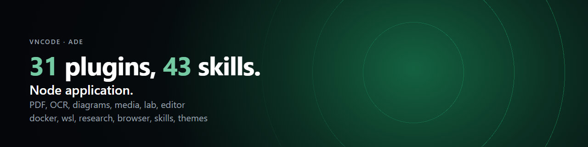

<picture>
  <source media="(prefers-color-scheme: dark)" srcset="assets/logo/vn-code-white-512.png">
  
</picture>

 

# vn-code

      

  Agent-Human ADE ⌨️ 
  Bundles <a href="packages/">Plugins</a>, <a href="docs/">Skills</a> and <a href="docs/">Interfaces</a>

Cross-platform Node ADE with core [DSH](https://www.deepseek.com/harness/en/) for professional Engineering and Design: every plugin is **Node.js** (plain JavaScript bundles, zero npm dependencies), and so is every launcher - there is no native code in this repository and nothing to compile. The launchers run on **Windows, macOS and Linux**.

## Run

| Windows | macOS / Linux |
|---|---|
| `scripts\run-web.bat` | `./scripts/run-web.sh` |

`run-web` starts the pinned harness (`npx @deepseek-ai/dsh@<pin> web --no-open`), watches for
the `dsh web:` ready line and opens **that URL** in Google Chrome, falling back to your default
browser. Chrome is looked for on PATH, in the standard install folders, and in the App Paths
registry on Windows; `-DefaultBrowser` skips it and `-NoBrowser` opens nothing.

The harness runs in the **foreground** of that window: Ctrl+C stops it. A machine needs the
pack installed once - `scripts\setup\install.bat` / `./scripts/setup/install.sh` - and every
run after that is the one file above. `-Help` lists every flag, `-Port <n>` moves it off the
default 3080, and `-DshHome <dir>` points one run at another harness home.

The DeepSeek key belongs to the harness, not to the launcher: it resolves `DEEPSEEK_API_KEY`
from the environment, then a `.env` beside the launcher, then `<home>/.env`. Add one in the
harness under **Settings > Models**, or put that line in `<home>/.env`.

The URL is opened only when it names a **loopback** address, and the launch token is never
written to a file - both rules are in [SECURITY.md](SECURITY.md).

## Plugins

Every package's own README is the reference for what it does, why it is built that
way and what it touches. The exact versions are in
[`.dsh-version.json`](.dsh-version.json).

| Package | What it adds |
|---|---|
| [`dsh-audio`](packages/dsh-audio/README.md) | A waveform surface for WAV, AIFF and FLAC: one track per channel, dBFS, selection and playback. It also draws the Media panel, which lists every audio, image, video and GIF file in the workspace. No microphone, no device list, no output routing. |
| [`dsh-browser`](packages/dsh-browser/README.md) | The Browser tab, replacing the shipped iframe one: a page rendered on the host in a disposable engine behind an https-only egress gate. It answers with a screenshot, post-script text and measured styles, for the tab and for three `browser_*` tools. Built and shipped but turned OFF, because the master layer disables the row. |
| [`dsh-cmdbar`](packages/dsh-cmdbar/README.md) | The command bar: the agent's own commands in a bottom dock, as a read-only transcript of the conversation log. It follows whichever conversation is on screen. |
| [`dsh-diagrams`](packages/dsh-diagrams/README.md) | Mermaid, TikZ and the Diagram Design kit as tabs and as seven `diagram_*` tools. The kit 204 examples and 44 documented types are vendored at a pinned commit and browsable on the index page. Every write, including a self-contained HTML document, is validated before it is stored. |
| [`dsh-docker`](packages/dsh-docker/README.md) | Docker or Podman as a surface: nine `docker_*` tools over the machine's own CLI, argv-only, with every removal confirmed by repeating the target. `docker_start` launches Docker Desktop or a podman machine and waits for the **daemon**. A Docker tab lists containers and images with their logs, and there is no `exec`, no `system prune` and no free-form `run`. |
| [`dsh-editor`](packages/dsh-editor/README.md) | Text and code tabs over a vendored CodeMirror 6, with save/create and a Markdown preview. Every extension is mapped through a guard, so an older engine opens the document unhighlighted instead of killing the tab. It also backs the `.scd`, diagram-source and research-document editors. |
| [`dsh-frontend-craft`](packages/dsh-frontend-craft/README.md) | Front-end design craft: Impeccable's Apache-2.0 corpus vendored at a pinned commit, plus its 61-rule detector built to WebAssembly inside the package. Five `fe_*` tools include `fe_render`, which renders a page in headless Chrome or Edge and measures contrast, tap targets and overflow. There is no `npx impeccable`, no engine download and no network. A Frontend tab shows findings, artifacts and the direction round. |
| [`dsh-gittree`](packages/dsh-gittree/README.md) | A read-only History tab: the workspace commits as a graph rail with lanes, merges and PR chips. Each commit lists the files it touched. It never runs a write. |
| [`dsh-image`](packages/dsh-image/README.md) | An image viewer that fits, zooms and pans, and reads the source pixel under the pointer. It opens from the Files tab and the Media panel. |
| [`dsh-image-upscale`](packages/dsh-image-upscale/README.md) | Four `upscale_*` tools over Real-ESRGAN, through the Python and torch this machine already has. It writes a NEW file and never the original, a manifest batch is a dry run by default, and the weight fetch refuses without `confirm`. Host-only, with no engine bundled. |
| [`dsh-media`](packages/dsh-media/README.md) | The pack ffmpeg owner: `media_probe`, `media_run` and `media_frames` over a pinned, SHA-256-verified ffmpeg copy. It also serves the Range routes the video tab streams through. No other package ships ffmpeg. |
| [`dsh-modal`](packages/dsh-modal/README.md) | The shared dialog surface (`modals` service) every control in the pack draws through. One dismissal and one focus model, instead of one per panel. |
| [`dsh-ocr`](packages/dsh-ocr/README.md) | One `ocr` tool over `tesseract` from PATH or, on Windows with nothing installed, the OCR engine Windows itself ships. It names the engine, the language and the page count, and refuses a missing language with the list of what it can read. Every answer is stated to be a transcription. |
| [`dsh-ollama`](packages/dsh-ollama/README.md) | Five `ollama_*` tools over the machine's own daemon: status that names `ollama serve` when nothing answers, one bounded inference with the daemon's own token counts and durations, and a benchmark that refuses fewer than 3 runs and reports a median with spread. Pull and delete require the tag repeated back, and embeddings report cosine similarity. A loopback fence refuses a daemon on another machine before any request. |
| [`dsh-open-in-app`](packages/dsh-open-in-app/README.md) | The file-manager half of *Open In…*, patched to open the OS file browser directly. `explorer.exe` on Windows, `open` on macOS, `xdg-open` elsewhere, WSL-aware. |
| [`dsh-pdf`](packages/dsh-pdf/README.md) | PDF as a surface the agent can read: `pdf_info`, `pdf_read`, `pdf_find`, `pdf_render` and `pdf_scan` over vendored pdf.js. A reader tab adds thumbnails and bookmarks. A scanned page is reported as a scan rather than returned empty. |
| [`dsh-proto-lab`](packages/dsh-proto-lab/README.md) | A prototyping lab the agent fills: five `lab_*` tools write a run into the workspace own `lab/<runtime>/<slug>/`. p5.js sketches open in a browser, and openFrameworks runs are three real C++ files built with your own projectGenerator and `make`. A runtime registry makes a third language one module and one line, and verification is a ladder that names the tier it reached. |
| [`dsh-research`](packages/dsh-research/README.md) | Research as a folder you keep: `RUN.json` plus a `passport.json` that records your instruction and every gate answer in your own words. Nine `rs_*` tools work over an append-only claim and source ledger, where numbers are data and a method record screening counts cannot increase. A disclosure record must be complete before the submission folder prints it, and two frame gates are answered by a person. Eight skills teach the tool surface, the method layer and the ethics layer. |
| [`dsh-rightbar`](packages/dsh-rightbar/README.md) | The right bar: tab strip, docking panel, expand button, Start page, and the `sidebarRight` service every tab type registers into. It is a generated fork of the shipped bar, so its layer disables the original rows. |
| [`dsh-rightbar-files`](packages/dsh-rightbar-files/README.md) | The Files tab type on that bar: a fork of the shipped file tree with open, rename and delete. It hands a file to the editor, image, audio or video tab that owns it. |
| [`dsh-rust-dev`](packages/dsh-rust-dev/README.md) | Rust as a surface: six tools over the machine's own `cargo`, `rustc` and `rustup`. `rust_status` reports the four facts that fail independently, `cargo_check` parses `--message-format=json` into codes and `file:line:column` with duplicates collapsed, and `rust_deps` answers duplicate versions and feature chains. `rust_backtrace` classes frames into your code, a dependency or the runtime. Four skills cover workspaces, diagnostics, debugging and egui/eframe/wgpu apps, and every cargo call is `--offline` unless `fetch: true`. |
| [`dsh-screenshot`](packages/dsh-screenshot/README.md) | Screenshots worth publishing: `shot_url` renders a page in a disposable headless Chrome or Edge with every other name resolved to `NOTFOUND`, at a named viewport with dpr, dark, full page or an element clip. `shot_window` and `shot_screen` capture a real application window or the display on Windows, and say so in one sentence elsewhere. `shot_place` writes a deterministic file plus a manifest and returns the README `` block with alt text required. No git, no credential, no bundled engine, three skills. |
| [`dsh-shaders`](packages/dsh-shaders/README.md) | GLSL that compiles for real: seven `shader_*` tools drive the machine's own browser, and every answer names the rung it actually reached (`v1-static` to `v4-measured`). Five dialects are kept apart because they are not interchangeable, and desktop GLSL is refused rather than faked. `shader_target` emits a web page, a `.frag` pair, ISF, an FFGL scaffold or Shadertoy names. A Shaders tab draws the live preview with one slider per `@param`. |
| [`dsh-skills`](packages/dsh-skills/README.md) | The Skills browser: a header button opens every skill this conversation loads, with its markdown and inline editing. It reads the same registry the agent does, so what you see is what is in effect. |
| [`dsh-sql-server`](packages/dsh-sql-server/README.md) | Seven `sql_*` tools over a container this row owns or the `sqlcmd` already on PATH. It keeps apart the four facts that fail independently: a server, a client, a listening port and the machine-wide ODBC driver. `sql_server start` waits until the server answers a statement, and `sql_script` loads a dump with BOM-aware code pages. |
| [`dsh-supercollider`](packages/dsh-supercollider/README.md) | SuperCollider the agent can play: eleven `sc_*` tools over one warm `sclang` session (about 31 ms a call, with state kept) and a hand-written OSC client to `scsynth`. The installed `.schelp` reference is indexed for `sc_help`, and the `.scd` workflow opens in the editor. Five skills teach the language, SynthDefs and live coding, and every example in them is compiled by a check. |
| [`dsh-themes`](packages/dsh-themes/README.md) | Header controls for themes (Nord, Monokai, Hacker, Cyber), screenshot and page zoom, plus the Markdown paper and the pack branding. It also hides the shipped account-menu Feedback row. |
| [`dsh-ui-state`](packages/dsh-ui-state/README.md) | The pack's own UI state, remembered host-side: zoom, theme, dock and column widths. It outlives the process, so a restart keeps the layout you left. |
| [`dsh-video`](packages/dsh-video/README.md) | A player tab that streams and seeks any container the browser can decode. An ffprobe facts panel names codec, size and frame rate, and one click remuxes when the browser cannot decode it. |
| [`dsh-vn-master`](packages/dsh-vn-master/README.md) | The pack's final layer: it installs last, so its row decisions win. It disables the four feedback/telemetry rows and the pack's own `browser` row, which is built and shipped deliberately off. Pack-wide row patches belong here. |
| [`dsh-wsl`](packages/dsh-wsl/README.md) | The POSIX half of this pack, testable on Windows: `wsl_status`, `wsl_run` and `wsl_path` over the machine's own WSL. `wsl_run` takes one argv array, never a shell string, with a deadline, a tree kill and a 1 MB cap per stream. The distribution is always named, because a Docker Desktop machine defaults to `docker-desktop-data`. |

The pack used to ship its own Files panel (`dsh-files`, earlier `dsh-focus`); that
was retired when the harness grew a real right Sidebar, and the installer prunes
the old names so an upgrade cannot double-mount.

## Third-party content the pack vendors

Some bundles carry somebody else's work inside them. Nothing is fetched at run
time — the profile installs a bundle as a live link, so an engine the plugin needs
on both sides of the app has to be on disk — and every vendored tree keeps its
upstream `LICENSE` beside its bytes.

| what | bundles | how it is kept honest |
|---|---|---|
| **Mermaid** 11.17.2 (`lib/vendor/mermaid.min.js`) | `dsh-diagrams` | `node packages/dsh-diagrams/vendor/build.mjs --check` re-hashes the recorded sha256 |
| **Diagram Design** — 204 worked examples, 44 documented visual types, 62 reference documents, MIT, [`cathrynlavery/diagram-design`](https://github.com/cathrynlavery/diagram-design) | `dsh-diagrams` | `node packages/dsh-diagrams/vendor/design/build.mjs --check` re-hashes the whole 277-file tree OFFLINE against a pinned commit |
| **pdf.js** 6.3.289 (`lib/vendor/pdf.min.mjs` + worker, cmaps, fonts, wasm) | `dsh-pdf` | `node packages/dsh-pdf/vendor/build.mjs --check`, per-file hashes plus a digest per tree |
| **Impeccable** 4.6.0 (`@2f46b7a`, Apache-2.0) — the 24-command skill corpus and 41 references, the 61-rule registry, and the detector built from the same `crates/core` + `crates/foundation` to `detect_bg.wasm` (4,558,054 bytes) + its CommonJS glue | `dsh-frontend-craft` | `node packages/dsh-frontend-craft/vendor/impeccable/build.mjs --check` re-hashes every vendored file offline against a pinned commit; the engine is built HERE from that pin (`build-engine.mjs`, 54 s cold) with its Apache `LICENSE` and `NOTICE.md` beside it, and `VERSION.json` records the four textual transforms as well as every byte |
| **Radiant** — 106 shader pages, 79 extracted fragment sources, MIT, [`pbakaus/radiant`](https://github.com/pbakaus/radiant) | `dsh-shaders` | `node packages/dsh-shaders/vendor/radiant/build.mjs --check` re-derives the catalogue from the committed pages OFFLINE; pages are byte-identical, and the two that are not statically extractable are named with the reason |
| **shader-skills** — 20 GLSL modules, 11 templates, 11 gallery pieces, 14 references, MIT, [`gokayfem/shader-skills`](https://github.com/gokayfem/shader-skills) | `dsh-shaders` | `node packages/dsh-shaders/vendor/shader-skills/build.mjs --check` re-derives the dependency closure offline, and the catalogue records which gallery piece proves each template |
| **awesome-glsl** — a 48-link curated index (**no shader code**), MIT, [`vanrez-nez/awesome-glsl`](https://github.com/vanrez-nez/awesome-glsl) | `dsh-shaders` | `node packages/dsh-shaders/vendor/glsl-links/build.mjs --check` proves `links.json` still matches the vendored markdown |
| **p5.js** 1.11.13 (`lib/vendor/p5.min.js`, LGPL-2.1) | `dsh-proto-lab` | `node packages/dsh-proto-lab/vendor/build.mjs --check` re-hashes the recorded bytes offline. 1.x on purpose: it is the last line with a self-contained classic-script browser build, which is what a run opened straight off the filesystem needs |
| **CodeMirror 6** (`lib/vendor/cm6.min.js`) and the forked shipped client bundles | `dsh-editor`, `dsh-rightbar`, `dsh-open-in-app` | the bundle's own version marker and the forked trees' hashes, both asserted by `scripts/checks/` |

A vendored tree names its pin in a `SOURCE.json`/`VERSION.json` and — where the
copy differs from upstream at all — says so in a `NOTICE.md`: the Diagram Design
kit is line-ending-normalized to LF so a Windows checkout cannot report phantom
drift, and that is the only change to it. A pin bump is deliberate — `--update-pin`,
rebuild, review the diff, run the package's own check.

## Security & license

- **AGPL-3.0-only** - see [LICENSE](LICENSE). Copyright (C) 2026 **vecnode**.
  The pack is copyleft: you may run, study, change and share it, and a version
  you **distribute or offer over a network** must carry its source under the same
  license. That is deliberate - vn-code is not to become a closed product on
  somebody else's bench. A commercial exception is available on request; see
  [CONTRIBUTING.md](CONTRIBUTING.md) for the CLA that keeps that possible, and
  [THIRD-PARTY-NOTICES.md](THIRD-PARTY-NOTICES.md) for the vendored trees that keep
  their own licenses (Apache-2.0, MIT, LGPL-2.1) and are **not** relicensed by this.
- [SECURITY.md](SECURITY.md): the threat model, the launch token, the code this pack
  runs on purpose (`dsh-supercollider`'s interpreter and its `eval` route among them),
  what the pack deliberately does not do, and how `check-no-secrets.mjs` keeps a
  credential out of a commit. Report a vulnerability privately, as described there.
- [ARCHITECTURE.md](ARCHITECTURE.md) is the deep dive; [docs/](docs) holds install,
  distribute, compatibility and per-host notes.
