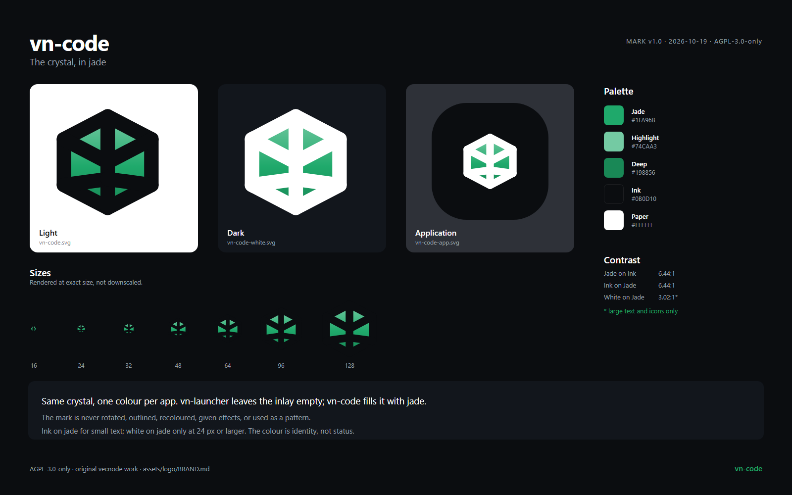

# The vn-code mark



A girdled crystal, shared with every application in the vecnode/vn suite. The lines are
vn-launcher's; the colour inside is vn-code's.

The suite keeps one mark and changes one thing per application: the **inlay**, the colour
that fills the facets. vn-launcher leaves it empty. vn-ranger fills it with ember. vn-code
fills it with jade. A new application gets the same crystal and a new inlay; it does not get
a new shape, a rotation, an outline variant or a different gradient direction.

This file is the design record. `MANIFEST.toml` is the machine-readable one: every palette
value, every proportion, and the SHA-256 of every file in this directory.

## Construction

The mark lives on the same 24-unit grid as vn-launcher and vn-ranger, so the three cannot
drift apart:

- hexagon vertices: `(12,2.8) (20.8,7.4) (20.8,16.6) (12,21.2) (3.2,16.6) (3.2,7.4)`;
- crown ridge: `(3.2,7.4) → (12,12) → (20.8,7.4)`;
- spine: `(12,2.8) → (12,21.2)`;
- girdle: `(12,15.4) → (3.2,16.6)` and `(12,15.4) → (20.8,16.6)`;
- stroke: `2.914` units, round caps, round joins;
- facets: six, separated by the crown ridge, the girdle and the spine.

Every endpoint sits on a hexagon vertex or on the spine. That is what keeps the facets
meeting cleanly instead of crossing. The inlay is one hexagon fill beneath the linework, so
the ridges stay crisp and the facets read as one crystal rather than six coloured tiles.

The inlay is a vertical gradient: `#74CAA3` at the crown, `#1FA96B` at 55%, `#198856` at
the base. The crown catches the light; the base sits deeper.

## Colour

| Token | Value | Use |
|---|---|---|
| Jade highlight | `#74CAA3` | Top of the inlay gradient; links on dark |
| Jade | `#1FA96B` | The application colour; badges, emphasis |
| Jade deep | `#198856` | Bottom of the inlay gradient |
| Ink | `#0B0D10` | Linework on light; the application tile |
| Paper | `#FFFFFF` | Linework on dark |
| Muted | `#9AA1AC` | Secondary text, never the mark |

The three jade stops are not a palette picked by eye. They are ember's **tonal ladder**,
solved for the same relative luminance and hue-rotated to green, which is why every
contrast pair below lands on vn-ranger's number. That matters most at the crown: the
application icon draws white ridges on it, and a brighter mint would drop white-on-crown
from `1.96:1` to `1.51:1`, melting the ridges into the top facets.

The banner in the repository root uses a neon accent (`#39FF88`). It is a **surface**
accent, not the mark: white on it is `1.29:1`, so it can never carry the crystal's ridges
and it is not part of this set.

## Contrast

Measured with the WCAG 2.x relative-luminance formula, and computed by the same code that
writes `MANIFEST.toml`:

| Pair | Ratio | Verdict |
|---|---:|---|
| Jade `#1FA96B` on Ink `#0B0D10` | 6.44:1 | AA for normal text |
| Ink on Jade | 6.44:1 | AA for normal text |
| White on Jade | 3.02:1 | Large text (24 px+), icons and non-text only |
| Jade on Paper | 3.02:1 | Large text, icons and non-text only |
| Highlight `#74CAA3` on Ink | 9.93:1 | AA for normal text |
| White on the crown | 1.96:1 | Ridges and linework only - never text |

**Ink on jade is the default for small labels.** White on jade is only for large type or
icons; a 13 px white label on jade is below AA and is not used.

Colour is identity, not status. The mark stays jade whether a check passes, a build fails or
nothing is running. Findings have their own semantic colours and never recolour the mark -
in a green application that rule is load-bearing, because a green facet must never be read
as "clean".

## Clear space

Keep a margin of **6 units** on every side, one quarter of the mark's 24-unit height. At
1024 px that is 256 px; at 24 px it is 6 px. Nothing enters that margin: no text, no badge,
no border, no other mark.

The application tile's own black square is the exception: the tile may touch the margin of
the surface it sits on, but the crystal inside it still keeps its clear space within the
tile.

## Minimum sizes

| Asset | Digital | Print |
|---|---:|---:|
| Bare mark (`vn-code.svg`, `vn-code-white.svg`) | 24 px | 10 mm |
| Application tile (`vn-code-app-*`) | 16 px | 6 mm |

Below 32 px the faceting costs legibility. At 16 px the bare mark reads as a green blob with
dark notches; use the application tile there, because the tile gives the eye a solid
silhouette and the jade gives it a colour to find.

## Which file to use

| Family | For |
|---|---|
| `vn-code.svg`, `vn-code-<size>.png` | Light backgrounds. Ink linework, jade inlay, transparent elsewhere. |
| `vn-code-white.svg`, `vn-code-white-<size>.png` | Dark backgrounds. White linework, jade inlay, transparent elsewhere. |
| `vn-code-app.svg`, `vn-code-app-<size>.png` | An application icon: the mark on the suite's black tile, with white ridges. |

There is no `.rgba` pair here, unlike vn-ranger: those files exist for an `egui::IconData`,
and vn-code's front door draws no window and no icon, so raw bytes would have no consumer.
If that changes, the recipe is 64×64 unmultiplied RGBA decoded from the 64 px PNG.

Sizes are 16, 24, 32, 48, 64, 128, 256, 512 and 1024 pixels square. Every PNG was rendered
at its exact size from the SVG, not downscaled from a master. Prefer the SVG wherever the
target accepts it.

## The application icon

- Tile: 1024 × 1024, corner radius **308** (30.1%), fill `#0B0D10`.
- Crystal: the same 24-unit geometry, scaled **22.73×** and translated **239.25 px**, so
  the visible mark is about 468 × 486 px and sits at the optical centre.
- Ridges: white; inlay: jade.

The tile is black, not jade. An icon has to hold its own against whatever is behind it: a
bare dark glyph disappears on a dark taskbar and a bare light one on a light taskbar,
whereas a black tile with a white crystal and a jade inlay reads on both.

## Where vn-code uses which

The **README header** uses the 512 px pair behind a `prefers-color-scheme` `<picture>`, so
one mark serves both GitHub themes.

Nothing in the application's interface draws this mark yet. The sidebar chip is a different
asset - `assets/vncode.svg`, a black disc, pinned by
`scripts/checks/check-client-bundles.mjs` and drawn by `dsh-themes` - and this set does not
replace it.

## Using it

**Do**

- put the light mark on paper and the white mark on ink;
- use the application tile for a launcher, a store listing or a favicon;
- keep the clear space and the proportions;
- pair the mark with the name in text when the mark is small;
- use ink on jade for small labels and buttons.

**Do not**

- rotate, skew, stretch, crop, outline, bevel or add a shadow to the mark;
- recolour the inlay, or change its gradient direction;
- use the mark as a repeating pattern, a texture or a loading spinner;
- put the bare mark on a busy photograph or a low-contrast background;
- place white text on jade below 24 px;
- use the mark to imply a passing check, a healthy build or a review it did not make;
- redraw the facets. The geometry is the suite identifier; a new application changes the
  inlay, not the crystal.

## Type

The wordmark is not part of this asset set. The brand sheet is set in the **system UI face**
(Segoe UI, SF, DejaVu Sans) rather than in a vendored typeface: vn-ranger ships Inter for
its sheet, and copying 830 KB of font into this repository to caption one image would make
"no third-party asset" untrue.

If a wordmark is ever added, use **Inter** (SIL Open Font License 1.1), set the name in
title case, and keep the same clear space around the lockup. Do not draw a custom wordmark
in the crystal's style: the crystal is the mark, and the name is the name.

## Accessibility

- The mark is decorative when the name is beside it; give the image an empty `alt` in that
  case. When it stands alone, `alt="vn-code"`.
- Colour is never the only signal. The inlay identifies the application; it does not report
  a state.
- The contrast pairs in the table above are the only ones approved for text.
- At small sizes, use the tile rather than a thin-stroked bare mark.

## Regenerating

Everything in this directory except this file and `README.md` is generated:

```sh
npm run logo              # rewrite the SVGs, the 27 PNGs, the sheet and MANIFEST.toml
npm run logo -- --check   # verify what is on disk; writes nothing
```

The renderer is `scripts/tools/logo/render.mjs`; the geometry and the palette live in
`scripts/tools/logo/marks.mjs`; the sheet's layout is `scripts/tools/logo/sheet.mjs`. It
rasterises with **Chrome or Chromium** (no npm package, no network): pass `--chrome <path>`
or set `CHROME` if the browser is somewhere unusual.

`--check` proves three things: the SVGs on disk equal the geometry in `marks.mjs`, every PNG
is the size its name claims with the transparency it claims, and every digest in
`MANIFEST.toml` is the file's own bytes. It does not re-render - a browser's PNG encoder is
not promised byte-identical across versions, so a fresh render is judged by its size and its
pixels rather than by a hash.

Changing the mark means changing `marks.mjs`, then `npm run logo`: the committed SVG is a
build product, like the PNGs, so the drawing exists in exactly one place.

## Licence

AGPL-3.0-only, like the rest of the repository. The mark is original vecnode work and
contains no third-party asset.
