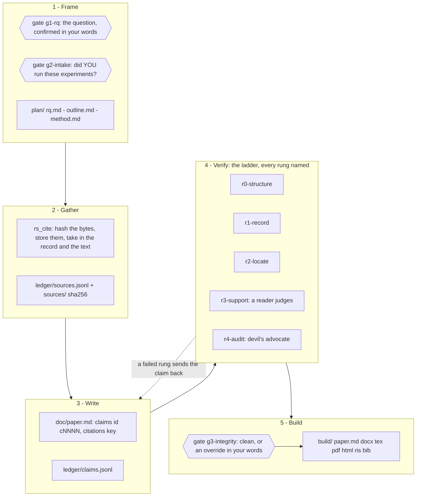

# DESIGN — `dsh-research`

**A design for research as a first-class surface of the pack: the agent gathers,
writes, verifies and builds a document — Markdown and DOCX — and the whole run is
a folder you can see in the right bar while it happens.**

This is a design, not a package. It is written to be argued with before a line of
it is built, because three of its decisions (where a run lives, what may leave the
machine, and what a tool may refuse) are load-bearing and cheap to change now.

The inspiration is [`Imbad0202/academic-research-skills`](https://github.com/Imbad0202/academic-research-skills)
(ARS), a mature Claude Code skill suite. What follows takes its *findings* and
re-implements the parts a dsh plugin can do *better than prose can*, while
deliberately not copying its text — see [Prior art](#prior-art-and-licensing).

## The one failure worth engineering against

An agent that writes research has exactly one quiet, catastrophic failure: **a
citation that does not exist, or a source that does not say what the sentence
claims it says.** ARS documents the scale of it (its README cites an audit of
111M references estimating 146,932 hallucinated citations for 2025 alone), and its
entire v3.7–v3.10 arc is an attempt to close it. Its answer is *prompt discipline*:
locator anchors in the frontmatter, a claim-audit pass, gates that "refuse" output
through a formatter the model is asked to obey.

A dsh plugin does not have to ask. Everything the agent writes can be made to flow
through a ledger that a **check** reads, and every citation can be a row that
either resolves to stored bytes or does not exist. So the spine of this design is
one rule:

> **A research document is a set of claim→source bindings, and no tool can
> upgrade a claim's status without the evidence the status requires.**

The model writes prose and proposes bindings. The plugin holds the ledger, the
bytes and the gate. A fabricated source is not "discouraged" — it has no row, so
it renders as a visible hole and the build refuses it by name.

## 1. A run is a folder

`rs_new` creates one run:

```
<root>/<slug>/
  RUN.json              kind, language, citation style, structure, created, config, plugin version
  passport.json         the ledger: instructions VERBATIM, gate questions + answers VERBATIM,
                        tool receipts, file hashes
  plan/                 rq.md · outline.md · method.md
  doc/paper.md          THE SOURCE OF TRUTH (Markdown; conventions in §2)
  doc/sections/*.md     optional; paper.md is assembled from them
  ledger/claims.jsonl   append-only, one line per claim
  ledger/sources.jsonl  append-only, one line per source
  ledger/reviews.jsonl  append-only, one line per review finding
  sources/<sha256>.pdf  the bytes, as retrieved
  sources/<sha256>.txt  extracted text + the record of HOW it was extracted
  sources/<sha256>.json url, at, http, etag, doi, license, sha256, textSource, coverage
  figures/              figures, referenced not drawn here (see §7)
  reviews/              r1-report.md · da.md · response.md
  build/                the built artifacts + build.json (what, when, with what, sha256)
```

- **Roots, and the pointer that makes them stable across sessions.**
  `DSH_RESEARCH_ROOT` wins; else the root **remembered** in
  `$DSH_HOME/dsh-research/library.json`; else `~/Desktop/vncode-research/` (the
  pack's own convention for a thing a person opens); else `<workspace>/research` on
  a machine with no Desktop. The first session that resolves a root writes the
  pointer, so a paper opened tomorrow from another conversation, with a different
  working directory, is the *same folder* — resolving the root from the current
  directory alone would quietly start a second library. Deleting the pointer is how
  a person makes it choose again, and `rs_open action=roots` prints both the root
  and the file that named it.
- **The research is the user's, so the panel edits it.** A `.md` file under `doc/`
  or `plan/` opens in an editor in the Research tab and saves straight to disk
  (`GET`/`POST /api/dsh-research/file`). This is deliberately NOT the agent's path:
  `rs_write` REFUSES prose whose claims are not declared, and a person may type any
  sentence they like. The human edit is *checked* instead — the route answers with
  the r0 structure verdict, and the panel shows `span-unrecorded` or
  `unknown-source` on the spot — which is the honest trade: never refuse a person
  their own file, never let the disagreement go unseen.
- **JSONL, not JSON.** Appending one line is atomic, diffable and never rewrites
  history; ARS's run ledger is the same idea in prose.
- **The passport quotes the user.** The initial instruction, every gate question
  and every answer go in *in their own words* — and `rs_read action=handoff`
  re-reads the passport and reports where a summary or a resumed session has
  drifted from it. A conversation compaction must not be able to launder a
  constraint.

## 2. The document's Markdown dialect

Standard Pandoc Markdown plus one construct, so the file is portable to Zotero,
pandoc, LaTeX and any editor:

- **A claim** is a bracketed span with an id: `[The programme raised completion by
  12 points.]{#c0142}`. `ledger/claims.jsonl` holds the row. In a `draft=watermark`
  build each span renders with a visible status marker and an endnote listing;
  in a clean build it becomes a bookmark and nothing more.
- **A citation** is Pandoc's own `[@smith2024effect]`, `[@key, p. 7]`, `[-@key]`.
  The key resolves in `sources.jsonl` or the build refuses it.
- **No reference list is ever typeset by the model.** The plugin computes it from
  the records, per style. Which fields came from an EXPORT or a fetched record and
  which the author typed is recorded per field
  (`src: crossref | ris | publisher | author`) and reported by `rs_verify` — the
  fields that can be wrong are exactly the ones a human typed.

## 3. The verification ladder

`proto-lab` established the idiom in this pack: verification is an ordered ladder
and **every answer names the rung actually reached**. A rung that could not run
says so with the reason, never a pass.

| rung | the claim it makes | needs | cost |
|---|---|---|---|
| `r0-structure` | document and ledgers parse; every `{#cNNNN}` has a row; every `[@key]` has a source; no orphans | nothing | ms |
| `r1-record` | every source has stored BYTES in `sources/` (sha256 recorded at ingest) and a record whose every field has a named origin (`crossref` / `ris` / `publisher` / `author`) — **and the title it claims appears in the text that was ingested** | nothing but the run's own files | ms |
| `r2-locate` | every located claim's quoted passage is really in the source's own text, at or near the stated locator | `sources/<sha256>.txt` | ms |
| `r3-support` | an independent reader judges, per claim, whether the *located passage* supports the claim **at the strength written** | a judge (subagent or session model) | min |
| `r4-audit` | a second, adversarial pass argues the strongest case against each surviving claim, the author replies, the reply is scored — and a source whose bytes CHANGED (a newer copy ingested, so the sha256 differs) re-opens every verdict that rested on the old bytes | a second reader | min |

Two orthogonal axes at `r3`, never a score: `verdict ∈ supported |
partially-supported | unsupported | contradicted | misattributed | not-checked`
and `strength ∈ aligned | overstated | understated`. A claim that writes "causes"
over a source that shows "correlates" is `supported` **and** `overstated`, and
both facts reach the report.

Three rungs have a failure mode that a careless implementation turns into a lie:

- **`locate-miss` is not `locate-inconclusive`.** Quote not found *in text we
  extracted* is reported as inconclusive whenever the extractor's coverage is
  below a stated floor, with the coverage number (characters extracted, streams
  skipped, fonts with no `ToUnicode` map). Telling an author their quote is not in
  the paper when the extractor failed is the worst answer this plugin could give.
- **A judge version is part of a verdict's cache key.** A verdict recorded by one
  prompt+model is never reused by another; the run reports how many verdicts are
  stale.
- **`r1` passing is not `r2` passing.** A record can name a real paper that is not
  the paper the document is quoting — the wrong hit in a search, a citation copied
  from someone else's bibliography. The guard is the source's own first page: the
  title the record claims must appear in the text that was ingested, or the source
  is flagged `title-mismatch` and cannot reach `r2`.

Two of these rungs are **offline by construction**, and that is a design decision
rather than a limitation: `r1` and `r2` read files that are already in the run.
Nothing in this plugin resolves, fetches or re-fetches anything (see §9).

## 4. Gates: human-in-the-loop, enforced instead of requested

ARS's deepest conviction is that the researcher decides at every stage and the
pipeline stops. In a dsh plugin that cannot be a request the model is asked to
honour — but it *can* be a route, a ledger and a refusal:

- `rs_new` opens **`g1-rq`** (is this the question?) and **`g2-intake`** — *did
  you run the experiments this paper reports?* — fail-closed: even a
  literature-only run must answer `no_experiments_declared`, in the user's words.
  An agent must never answer that question for a human.
- `rs_build` opens **`g3-integrity`**: either integrity reached `r3` with zero
  `unsupported`/`misattributed` claims, or an override **with the user's reason
  recorded verbatim** in the passport.
- A tool that meets an unanswered gate refuses with a machine-readable code
  (`GATE_UNANSWERED`) naming the gate id and the address that answers it.
- **The gate is answered in the right bar** (§8), not in the chat: a form, a free
  text box, a submit. The next tool call quotes the answer back.
- **Only `r3`/`r4` are the model's job.** A route can re-run `r0`, cached `r1`
  and `r2` any time, because those need no judgement. A route never writes a
  status that requires a reader.

## 5. The tool surface — nine verbs, each a different permission

The pack's rule is that near-synonyms spend the model's attention on the choice.
These are not synonyms: each has a different *permission*, which is why there are
nine and why two candidate tools were deliberately dropped.

| tool | one line | permission |
|---|---|---|
| `rs_open` | where runs are, what each is, where this one stands, what this host can build, does the ledger still agree with the summary | read |
| `rs_new` | start a run; opens the two gates | create |
| `rs_plan` | write/read rq, outline, method | write inside the run |
| `rs_read` | the one reader: doc, section, claims, sources, reviews, passport, build | read |
| `rs_write` | write Markdown; validates every `[@key]` (`UNKNOWN_CITATION` lists near-misses) and every claim id | write inside the run |
| `rs_cite` | INGEST a source: hash the bytes the person or the agent already has, store them, take in the record and the text, attach a locator | **the only tool that may write into `sources/`** |
| `rs_verify` | run the ladder, record verdicts, report the rung reached | may change a status, only with evidence |
| `rs_review` | the panel, the devil's advocate, the R&R matrix, the response | writes review artifacts only |
| `rs_build` | md / docx / tex / pdf / html / ris / bib / enw, per style, clean or watermarked | the only tool that writes outside the run |

Dropped on purpose: **`rs_status`** (folded into `rs_open action=status`) and
**`rs_delete`** (a run is deleted by deleting its folder; no tool of this plugin
ever deletes anything).

Two refusals worth naming because they are the mechanism, not politeness:
`STATUS_REQUIRES_EVIDENCE` (an `r3` verdict with no locator cannot be recorded)
and `CONCESSION_BELOW_THRESHOLD` — the devil's-advocate protocol scores every
rebuttal and permits a concession only at the stated threshold; ARS asks for that
in prose, this plugin **refuses to record** a below-threshold concession.

## 6. Build: a DOCX writer with no dependencies

Rule 7 of the pack (zero npm dependencies) makes this the largest single piece of
engineering in the plugin — and it is the piece that makes the plugin worth having,
because "I can produce a DOCX" is the difference between a chat transcript and a
submission.

- `lib/docx/zip.js` — a real ZIP writer over `node:zlib.deflateRawSync` with a
  CRC-32 table, **and fixed DOS timestamps**, so the same Markdown and the same
  config produce **byte-identical output**. Plus a reader, for the check.
- `lib/docx/model.js` + `markdown.js` — a stated CommonMark+Pandoc subset
  (headings, paragraphs, emphasis, lists, blockquote, tables with alignment,
  fenced code, images, footnotes, links, hard breaks) into a document model.
  Anything outside the subset is **reported by name with its line number**, never
  silently dropped.
- `lib/docx/styles/<id>.js` — one module per house style exporting page setup,
  `styles.xml` and numbering: `apa7`, `chicago-notes`, `chicago-author-date`,
  `mla9`, `ieee`, `vancouver`, plus a neutral `plain`. A runtime-registry shape,
  the same as `proto-lab`'s runtimes: a new style is one module and one line, and
  a style that is not registered is a refusal that names the ones that are.
- The details a naive generator gets wrong, all of which are in scope: a real TOC
  field with `<w:updateFields w:val="true"/>` so Word fills it without F9, `REF`
  cross-references, `PAGE`/`NUMPAGES` in the footer, hanging-indent reference
  lists, footnote parts for Chicago notes, and images sized from the image's own
  pixel dimensions and DPI.
- **Determinism is a real claim here, and it is scoped**: the *format step* is
  byte-reproducible and `build.json` records the sha256 of every output. The
  *prose* is not, and the docs say so — ARS is honest that its `repro_lock` is
  documentation rather than a replay guarantee; ours is a guarantee about a
  smaller thing.
- The other formats: `tex` (self-contained, engine chosen by style), `html`
  (self-contained), and `ris` / `bib` / `enw` — the escape hatch that hands the
  whole bibliography to Zotero, EndNote or pandoc when a user wants a citation
  style this plugin does not implement. State the limit once: six styles, and the
  BibTeX is the way out.
- **A PDF is the user's step, not the plugin's.** `rs_build format=pdf` prints the
  exact command for the `.tex` or the `.docx` it just wrote (`pdflatex paper.tex`,
  `pandoc paper.md -o paper.pdf`) and runs nothing — because running an engine
  found on PATH is a child process, and this plugin spawns none (§9). The design
  paid for that decision here and it is worth the cost: the build is pure
  JavaScript over files in the run, so the same input gives the same bytes
  wherever it runs.

## 7. Composition, not duplication

The pack already has the parts, and one plugin talking to another over HTTP is an
established precedent here (`dsh-video` streams through `dsh-media`'s Range route
and says so when it is absent). One row in this table is a *change to another
package*, and it is called out rather than assumed.

| need | owner | how |
|---|---|---|
| reading a source's text | **dsh-pdf** (`pdf_read`) / **dsh-ocr** (`ocr`) | the AGENT reads the document with the tool it already has and hands the text to `rs_cite`. This plugin extracts nothing itself: no PDF parser, no child process, no second opinion about what a page says. The source record names who extracted the text (`textSource`) and, when the extractor reports one, its coverage |
| figures | **dsh-diagrams** | the research tools never draw. A figure is a diagram id or a PNG in `figures/`; `rs_build` embeds it, and reports `figure-not-embeddable` with the path when it cannot |
| editing the Markdown | **dsh-editor** | the workbench opens the file's address; the editor is the editor |
| reading a source at a locator | **dsh-pdf** | the claims table opens the stored PDF in the PDF tab |
| showing the built DOCX | **dsh-open-in-app** | "Open in app" reveals the file where a person can double-click it |
| the skills browser | **dsh-skills** | the six skills below are readable like any other |

Every row above is a surface the USER or the AGENT drives. There is no row for
"this plugin asks another package for something over HTTP", because a loopback
request is still a socket — so the plugin owns no client, and the pack keeps
exactly one owner per capability.

## 8. The right bar: research you can watch

**One page type, not two** — and that changed during phase 0, for a reason worth
recording. The plan was a workbench type plus an index type; the pack's own
precedent (`dsh-proto-lab`'s Lab tab) is better here: a page type that addresses
no file needs no address grammar, and in a 300px column a run list ABOVE the
selected run beats a separate index the user has to navigate away from. So:

- **`research`** — one page type with no `patterns` and no `canOpen`, so it claims
  no file and cannot take a surface away from one. Registered through
  `ctx.sidebarRightTabs` with a `guide` entry on the "+" control's Start page
  (whose `title` and `description` are FUNCTIONS — a string throws inside the Start
  page's own render). Inside it: the run list, then the selected run.

The panel is one narrow scrolling column, ordered by what is actionable:

1. **Gates first, when one is pending.** The question, the options, a free-text
   box for *your* answer, an override-reason box, Submit. An answered gate
   collapses into a timeline. This is the surface that makes §4 real.
2. **Outline** — sections with word counts and claim counts; click to preview, or
   open in the editor.
3. **Claims** — filter by status × rung; each row shows the claim, its chip, the
   rung, the locator (page + quote excerpt), the judge's reason, and the DA's
   attack with the author's scored reply. **There is deliberately no "mark
   verified" button**: only a check upgrades a status.
4. **Sources** — the record with its origin per field, the title-match verdict, the
   ingested hash and when it arrived, and a flag when a NEWER copy changed the
   hash. A source with no bytes is listed first, because it is the one that cannot
   be cited.
5. **Build** — one button per format, each naming the rung reached and the sha256,
   and the refusal reason where a gate blocks it.
6. **Egress** — **there is nothing to show, and the panel says so**: this plugin
   made no request, and the sources in this run arrived as files. A run that shows
   an empty list here is the feature, not a gap.
7. **Provenance** — the passport: instructions verbatim, gates, tool receipts with
   file hashes, and the handoff-check result.
8. **Preview** — hands off to the shipped Markdown document body rather than
   reimplementing a renderer.

**Live without a refresh.** While the tab is visible it stat-polls
`GET /api/dsh-research/project?slug=…&rev=N` every 1.5 s and stops the moment it
is hidden, so what the agent is doing appears as it happens. The stat-poll idiom
is already the pack's (`dsh-client-hmr` does exactly this at 500 ms).

Routes — exact paths, `GET`/`HEAD`/`POST`, all behind session auth:

| route | answers |
|---|---|
| `GET /api/dsh-research/state` | the root and its provenance, runs, stages, gates, capabilities, versions |
| `GET /api/dsh-research/project` | the whole workbench payload for one run, in one round trip |
| `GET /api/dsh-research/source` | the stored text of one source around a locator |
| `GET /api/dsh-research/artifact` | a built artifact's bytes (download, or reveal) |
| `POST /api/dsh-research/gate` | answer a gate; appends to the passport with the timestamp |
| `POST /api/dsh-research/verify` | re-run the rungs that need no model (`r0`, `r1`, `r2`) |
| `POST /api/dsh-research/build` | build a format |
| `GET /api/dsh-research/health` | the snapshot the tracked checks read |

Two rules about these: **the route and the tool are one code path with two
callers**, so the GUI and the agent can never disagree; and **no route runs a
model**, which is why the button can honestly say which rungs it re-ran.

Phase 0 ships four of the eight (`state`, `project`, `gate`, `health`); the other
four arrive with the phases that need them, and the table is the target.

## 9. What leaves the machine: nothing

Rule 7 forbids network egress a plugin starts on its own, and this design goes
further on purpose: **the plugin has no client at all.** No `node:http`, no
`node:net`, no `fetch`, no DNS, no proxy, no API key, no user agent, no cache of
responses — so there is nothing to audit, no allowlist to keep current, and no
consent switch that can be left in the wrong position.

- **Literature arrives as a file.** The agent uses the harness's own `web_fetch` /
  `web_search` (or the user downloads from their library) and then calls `rs_cite`
  with a path. The bytes are hashed into `sources/<sha256>.<ext>` at ingest, so the
  retrieval happened once, outside this plugin, under a policy the user already
  trusts.
- **Imports are files too**, which is how real researchers work: a `.ris` /
  `.bib` / `.nbib` export from Zotero, EndNote, Scopus or PubMed is read and its
  records become `sources.jsonl` entries, each field carrying the origin it came
  from — so a field the export supplied is never confused with one the author
  typed.
- **The plugin spawns nothing either.** No `child_process`, no `pdftotext`, no
  converter discovered on PATH. Every transformation it performs is in-process
  JavaScript over files inside the run — which is exactly what makes the DOCX
  writer (§6) a dependency-free implementation rather than a pandoc wrapper.
- **What it therefore cannot do**, stated once and in the README: it cannot verify
  that a DOI exists by asking a registrar, cannot detect a retraction by watching
  a service, and cannot discover a paper the agent did not bring it. `r1` is a
  provenance rung, not an existence check, and the ledger records *who supplied
  each fact* rather than pretending the plugin confirmed it.
- The package's own check asserts the absence, against the source: no
  socket-capable import, no `fetch` call, no spawn, and an allowlist on the two
  environment variables it may read (`DSH_RESEARCH_ROOT`, and the home directory it
  looks for a Desktop in). A BEHAVIOURAL proof is impossible for a capability that
  is absent — so the check says out loud that it is a source assertion, and proves
  the rest by driving every tool and route.

## 10. Skills, shipped beside the package

Both installers already copy `packages/<name>/skills/<skill>/` into
`$DSH_HOME/skills` by walking the folder, so six skills cost no installer change:

| skill | teaches |
|---|---|
| `research-project` | the run model, the folder, the passport, the gates, resuming, the handoff check |
| `research-sources` | where a source comes from when the plugin fetches nothing (the agent's `web_fetch`, a library export, a file on disk), the ingest step that hashes it, field provenance, RIS/BibTeX in and out, locators |
| `research-writing` | structures (IMRaD, thematic review, theoretical, case study, policy brief, conference), section recipes, claim-strength vocabulary, style calibration, figures, the AI-disclosure artifact |
| `research-verification` | the ladder, the evidence each rung requires, `locate-inconclusive`, the judge prompt and its two axes, drift, how to report a rung |
| `research-review` | the panel (journal-fit + three roles + DA), criterion-bound findings, the concession protocol and why the tool refuses, the R&R matrix, re-review, the response |
| `research-formats` | the six styles and their slots, every build format, submission packaging (anonymized ms + title page + figures + cover letter), the BibTeX escape hatch |

Each carries `examples/` that a check parses and, where runnable, actually runs —
the contract `dsh-proto-lab` established.

## 11. What changes outside the package

Small on purpose. **No core row is disabled, nothing is forked, nothing is
vendored, nothing is downloaded, and no npm dependency is added** — the same
posture as `dsh-pdf`.

- `packages/dsh-research/` — row `research`, inserted by its own layer
  (`cordis.patch.yml`, one `insert`), `dsh.client` + `exports["./client"]`, its
  `lib/*.js` modules (the run model, the ledger, the ladder, the DOCX writer under
  `lib/docx/`, the style registry under `lib/docx/styles/`), `lib/client.js`, and
  six skills. **No other package changes at all** — the earlier draft added one
  route to `dsh-pdf` for text extraction, and §9 removed the need for it: the agent
  reads a document with `pdf_read` and hands the plugin the text.
- `.dsh-version.json` — a `dsh-research` entry (version, `rows: ["research"]`,
  role, uses, requires). This is **required, not documentation**: the manifest
  check fails when a bundle under `packages/` is undeclared or when a declared
  version has drifted from `package.json`.
- `scripts/dist.ps1` — sentinel lines (`lib/run.js`, `lib/client.js`, and a
  skill's `SKILL.md` once phase 1 ships one) so a distribution missing the package
  fails loudly rather than quietly. `include packages` and `include docs` already
  carry the rest.
- `ARCHITECTURE.md` — one table row; `AGENTS.md` — the package list.
- **`scripts/checks/check-node-routes.mjs` needs NO edit while this package ships
  routes but no skills.** The pack's convention, read off the file itself: a
  package with its own check under `packages/<name>/checks/` is driven THERE —
  `dsh-proto-lab`, `dsh-pdf`, `dsh-media` and `dsh-supercollider` have no
  route/tool block in the pack-wide check — while the one hardcoded list it does
  carry is the packages whose BUNDLED SKILLS must appear in the skills registry.
  That list gains `dsh-research` in the phase that ships the first skill, not
  before. The only pack-wide edit this change needed was the manifest entry above.

## 12. The checks — the contract

Inside the package, run with `npm run check`, and additional to the pack-wide list
(rule: never weaken one to make a change pass; skip loudly with the reason).

| script | what it proves |
|---|---|
| `check-research-node.mjs` | **SHIPPED in phase 0.** The run model (create/read/write round trip, atomic writes), the path policy refusing a bad slug, a `..` walk, an absolute path, a NUL byte and **a symlink inside the root pointing out of it**, every gate refusal (`TEXT_REQUIRED` even for a plain "no", `REASON_REQUIRED` on an override, `GATE_ALREADY_ANSWERED`, `VALUE_INVALID`, `GATE_UNKNOWN`), the three tools against their own declared `output.schema` AND a lossless JSON round trip, all four routes with real `Request`s, activation with and without a connection service, and the §9 security claim — labelled in the output as the source assertion it is |
| `check-research-docx.mjs` | build a document, re-open it with the package's own ZIP+XML reader, assert the parts, the styles and the reference list, assert **two builds are byte-identical**, and — when `pandoc` exists — let a *foreign* parser read the DOCX back and compare the text. A CHECK may spawn pandoc; the plugin may not (§9). Skips loudly without it |
| `check-research-ingest.mjs` | `rs_cite` against files the check builds: a hash recorded at ingest, a second ingest of changed bytes reported as a hash CHANGE rather than a silent replace, a `.ris` import whose fields keep their origin, a record with no named origin refused, a title that does not appear in the ingested text flagged `title-mismatch`, and a locator recorded against a source with no bytes refused |
| `check-research-locate.mjs` | `r2` against text the check builds: quote found on the page, found on another page (`locate-offpage`), absent (`locate-miss`), and a thin or partial extraction reported as `locate-inconclusive` with its coverage — the distinction that keeps a weak extraction from slandering a source |
| `check-research-client.mjs` | the client bundle through the real module table, activated against a stub cordis and rendered with a real React runtime; the pure halves (`pendingGates`, `answerLabel`, `formatStamp`, `wantsReason`) driven directly; the `dsr-` CSS prefix pinned |
| `check-research-render.mjs` | **a real headless browser opens the tab against a fixture run and the pixels are read**: the run list, the "waiting" badge, the pending gate's form, the provenance quotes. No browser ⇒ skips loudly, exit 0 |
| `check-research-examples.mjs` | every fenced snippet in the six skills, parsed and, where runnable, executed against a scratch root |

Plus, for the area: `check-no-secrets.mjs`, `check-node-routes.mjs` (the manifest),
`check-client-bundles.mjs` (the tab, rendered for real), `check-dist-layout.mjs`,
`check-skill-examples.mjs` once a skill ships.

And because §11 touches `dsh-pdf`: `check-pdf-node.mjs` and the route COUNT
`check-node-routes.mjs` pins for it both move by the one added route. The pack has
been bitten by exactly this before — the harness's own comment records dsh-pdf
"counting SEVEN routes where the code registers TEN" — so the count is asserted,
not derived, and adding a route means updating the assertion in the same change.

## 13. Limits — stated, not discovered

- The plugin cannot establish that a source is **real**: it did not ask a
  registrar, so `r1` records *provenance* — whose bytes, whose record, which field
  from where — and never claims existence. A convincingly forged record that
  happens to carry matching text passes `r1`, and the README says so.
- Text comes from whichever tool the agent used. This plugin extracts nothing, so
  `textSource` names the extractor and `coverage` is whatever that tool reported;
  `r2` is only as good as the text it was handed, which is why
  `locate-inconclusive` exists as a verdict of its own.
- `r3`/`r4` are model judgements: **recorded, not proven**. The judge, the prompt
  version, the passage and the reason are all in the ledger so a reader can
  disagree with a specific judgement.
- No Web of Science, no Scopus, no paywall, no DOI existence check, no retraction
  watch — the plugin asks no service anything, by design.
- Six citation styles, and anything outside the Markdown subset is refused by name.
- Byte-determinism applies to the format step, not to prose.
- A run is a folder; this plugin never deletes one.

## 14. Prior art and licensing

ARS is **CC-BY-NC 4.0**. This design therefore **does not vendor or copy its text**;
it credits the ideas and re-implements them, which is both cleaner for a pack
shipped through npm and the honest reading of "adapt" under a NonCommercial term.

Credit, explicitly, in the package's `NOTICE.md`: the pipeline shape and the
stage-gate discipline, the authority-over-instructions boundary, the run ledger
with the user's own words, the experiment-intake declaration, the claim-audit
idea, the field-provenance/trust-chain idea, the concession-threshold protocol,
the R&R traceability matrix, and the readiness to publish measured results with
their uncertainty attached — all from **Academic Research Skills by Cheng-I Wu**
(and its contributors), itself citing Lu et al. 2026, Zhao et al. 2026, Ren et al.
2026, Gartenberg et al. 2026, Wang, Li et al. 2026 and Brodeur et al. 2026. The
papers ARS leans on are worth reading directly, and two of them are the reason
this design keeps the human on every gate: Brodeur et al. found AI-led teams
reproduced 37% of published results against 94% human-only, and the *Organization
Science* editorial found heavily AI-written submissions desk-rejected more often.

What is *ours*, not inherited: the ledger as the build's input rather than as
advice, the rung ladder with `locate-inconclusive` split from `locate-miss`, the
gate answered in the right bar, the byte-reproducible DOCX, and interfaces that
refuse rather than warn.

**Nothing here needs Claude, or any vendor's CLI, API key or agent runtime.** ARS
is a Claude Code plugin pack: its slash commands, hooks, subagents, its
`ANTHROPIC_API_KEY` prerequisite and its optional cross-model verification are all
parts of a harness this pack does not have. This design keeps only the method and
drops the machinery — the tools, the routes, the tab and the checks are plain
JavaScript on the dsh tool/route/slot registries, the judge in `r3`/`r4` is a dsh
subagent or the session model, and there is no second provider anywhere in it.

## 15. Phases — each one shippable and checkable on its own

| phase | what lands | the check that proves it | state |
|---|---|---|---|
| 0 | the run model, the passport, the two gates, `rs_open`/`rs_new`/`rs_read`, the routes, the Research tab with the gate form and the live poll | `check-research-node.mjs`, `check-client-bundles.mjs` | **SHIPPED** |
| 1 | `rs_plan`, `rs_write`, claim + citation syntax, the append-only source and claim ledgers, `rs_cite` (ingest only), the RIS/BibTeX/MEDLINE/EndNote engine, six citation styles as a registry, `format=md`, the first skill | `check-research-node.mjs`, `check-research-refs.mjs`, `check-research-styles.mjs` | **SHIPPED** |
| 2 | the panel: the gates form, the passport, the outline, the claims ledger with its status chips, the sources ledger with what can be checked, the build row, the in-place editor with its structure verdict, the library pointer | client (rendered for real), node | **SHIPPED** except the headless render check |
| 3 | the DOCX writer (seven modules, no dependencies, byte-deterministic), the HTML builder, RIS/BibTeX/ENW export from the panel, the integrity gate | `check-research-docx.mjs` (+ pandoc as the foreign reader) | **in progress** |
| 4 | `r1-record` and `r2-locate`, the `rs_verify` tool that records a rung, the ladder report | `check-research-node.mjs` (the whole ladder driven end to end) | **SHIPPED** |
| 5 | `r3`/`r4` recording, the reviewer panel, the DA concession gate, the R&R matrix | ladder with a stub judge, `rs_review` driven end to end | **SHIPPED** |
| 6 | `tex` output and the printed PDF command, submission packaging, the disclosure artifact, hash-change re-opening | docx/latex, node | |

Rough size, for planning rather than pride: the host half of `dsh-pdf` is ~1,825
lines with a 40 KB client bundle; this is a comparable package plus the OOXML
writer, so **plan for the biggest plugin in the pack**. What has landed measures:
`lib/run.js` (the model, the pointer and the gates), `lib/syntax.js` (the dialect),
`lib/ledger.js` (the append-only ledgers), `lib/doc.js` (assembly, r0, rendering),
`lib/verify.js` (the rungs a file can run), `lib/build.js` (the builders and the
gate), `lib/view.js` (the panel payload), `lib/refs.js` 1,471 (four formats,
round-tripped), `lib/styles/` ~1,600 across eight modules, `lib/docx/` ~2,100
across seven, `lib/tools.js` (eight tools), `lib/index.js` (the row),
`lib/client.js` (the tab, its editor and its five sections), three bundled skills,
and five checks.

The lessons the phases actually produced, worth keeping:

- `r2`'s miss/inconclusive split is not a detail. Driving it found `r2` passing a
  text BODY where the text RECORD was expected, so `coverage` was always undefined
  and every miss came back inconclusive - the ladder quietly softening every
  finding it made.
- A claim written as a Markdown ANCHOR LINK (`[sentence](#c0142)`) reads exactly
  like a claim span to a person and tracks nothing. It is now a `broken-marker`.
- Three of the six citation styles printed no DOI at all until the styles check was
  driven against pinned strings: a Works Cited entry a reader cannot follow is a
  citation that does not work.
- A skill is prose about a tool surface, so it needs a check of its own: see
  `check-research-examples.mjs`, which holds every `rs_*` name, parameter value,
  refusal code, claim span and citation a skill teaches against the code.

## The pipeline


