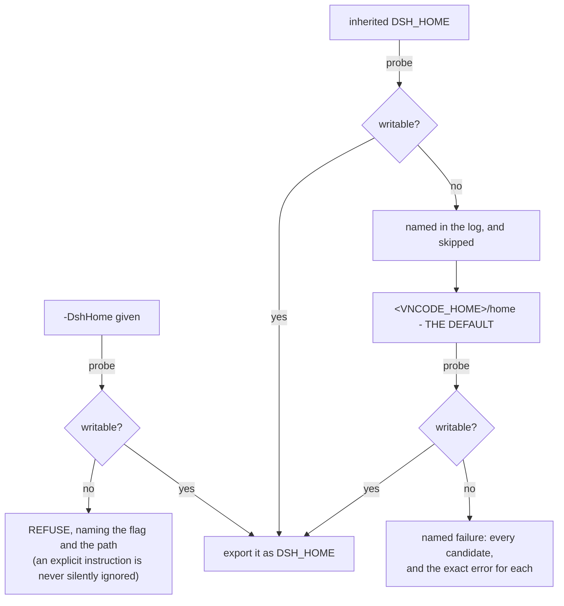

# PLAN-egui-shell.md — the vncode shell, with the Rust app as the father

## The revision, in one paragraph

The shell that exists is a **supervisor**: it opens a control panel, starts the pinned
`dsh web` when you press Start, and hands the printed address to your browser. It is not
the **father** of that instance, and two failures follow from it. It *inherits* the
harness home instead of choosing one, so a home this account cannot write in — an ACL an
elevated run left behind, a read-only mount, or a parent process that confines what its
children may write — is a refusal (`the harness home … is NOT writable`), and the app
opens on a dead end. And it does not own the surface: it throws the URL at whatever
`explorer.exe` happens to do with it, names no browser, and reports nothing if none opens.
This revision makes the Rust app the father. It **resolves, creates and proves** one root it
owns — `$VNCODE_HOME`, whose `home/` is handed to the harness as its `DSH_HOME`, so the keys,
sessions, profiles and skills live in a directory this app created rather than in `~/.dsh`,
which belongs to whichever harness used it first; it **composes** every child's environment
instead of inheriting one; and it **owns the surface** — a browser table (`browser.rs`,
Chrome first, everything else reachable, the OS opener as the floor), the choice remembered
in its own root, and every path it uses cleaned, resolved and proved before a child sees it.
TThe security core does not move: the launch token never leaves memory, only a
loopback URL is loaded, Stop still kills the whole tree and proves the port free, no core
file is patched, and there is still exactly one install target.

## Where this plan stands

| phase | state |
|---|---|
| **M0 — the father's home** | **done.** `$VNCODE_HOME` is the root the app creates and proves, `<root>/home` is the default `DSH_HOME`, both ladders are data in `home.rs`, one composer builds every child's environment, the installer is given `-DshHome <chosen>`, the geometry moved to the root, the panel draws the root, the home with its refusals and the composed environment, Adopt copies the durable things, and `check-shell.mjs` drives all of it |
| **M1 — supervisor parity** | **done.** The pure halves moved with their tests, the crates exist, and the ready line, the refusals, Stop and the port assertion are driven by `scripts/checks/check-shell.mjs` |
| **M2 — the control panel** | **done.** It opens idle with no child process, shows the status, the install state, the location map and the log, starts on Start, stops the whole tree on Stop, and installs or removes the pack from its two buttons |
| **M3 — the surface** | **done.** No embedded web view (the owner's decision, section 4): the app finds the browser on the machine with `browser.rs` - Chrome first, every other Chromium, Firefox, and the OS opener as the floor - remembers the choice in its own root, opens the loopback URL as ONE argv element, and says which browser it used. `-Mode embed` is refused by name |
| **M4 — distribution** | **done, differently.** `src-tauri` is deleted and `check-shell.mjs` is the contract. There is no distributer on purpose: the distribution is this app beside the pack it installs, and the panel's **Install pack** / **Uninstall pack** run `scripts/setup/install.*` / `uninstall.*`, the entry points a person clicks |
| **Later** | the Ollama provider (appendix) and a second runtime variant: unscheduled, and not dependencies of anything. **An embedded web view is not on this list**: the owner's decision is that this app shows the interface in a browser, and `docs/PLAN-egui-shell.md` no longer plans a pane |

The phase numbers changed in this revision: **M0 is now the father's home**, and the pane
that used to be M3 is **gone** — this app shows the interface in a browser, by the owner's
decision, and there is no web view to build (section 4). The comments and panel strings that
called the pane "M0 of docs/PLAN-egui-shell.md" (`vn-shell/src/main.rs`,
`vn-shell-egui/src/lib.rs`, `vn-shell/Cargo.toml`, `app/README.md`) were corrected with it,
because a plan and the code that cites it disagreeing about which phase is which is how a
"fix" lands in the phase nobody is working on.

Three things this plan still treats as fixed:

1. **The DeepSeek path is not touched.** The harness's own adapters, its credential layers
   and its route are exactly as they are today (section 9).
2. **One install target** — the `web` profile, started by the pinned `dsh web`, by the same
   code path `scripts\run-web.bat` uses (section 6). The shell adds a window, a panel, a
   pane and a Stop button; it patches no core file and starts no second server.
3. **No CI**, on purpose.

---

## 1. What "the father" means, as a contract

A father app is not a wrapper around somebody else's process; it is the process that
**decides** the facts its children live in. Six duties, each one testable, and each one a
gap today:

| | duty | today | after |
|---|---|---|---|
| **F1** | **own the home.** One root the app creates, proves by writing, and exports to the harness under the name the harness knows (`$VNCODE_HOME`, exported as `DSH_HOME`) — unless a person or a parent named another home | the harness's shared `~/.dsh` is inherited, unverified, and a refusal when unwritable | `DSH_HOME` is always exported, and its default is `<app root>/home` inside a root this app proved |
| **F2** | **compose the child's environment** — `DSH_HOME`, `npm_config_cache`, `PATH`, the working directory, the console markers — and print what it composed | partially: the cache is chosen, the console markers are cleared for the installer only, `PATH`/`cwd` are inherited, and the home is exported only when the user named one | one `compose_env(plan)` per child, unit-tested, and the panel draws the result |
| **F3** | **own the tree.** Stop kills everything the harness started, and the port is then *checked* | done on Windows (Job Object + `taskkill /T`) and in `kill_tree`; a kill of the shell itself still leaks on POSIX | unchanged, plus the POSIX detachment note in section 10 |
| **F4** | **own the surface.** The harness UI appears in a window this app owns, or in a browser this app chose and can name | the browser hand-off only, with no pane and no record of which browser answered | `embed` where it works, `chrome` as the floor, and the choice printed |
| **F5** | **own the install.** The pack goes into the home the father chose, not into whatever `~/.dsh` happens to be | the Install button runs the installer with no `-DshHome`, so it targets the harness's default home whatever the app chose | `-DshHome <chosen>` and a composed environment, on both entry points |
| **F6** | **never invent a fact it has not proved.** A home is handed over only after a write succeeds; a runtime only after it prints a ready line; a URL only after it is loopback | already true of the runtime and the URL | extended to the home, which is the fact this revision adds |

## 2. `$VNCODE_HOME`: the app's root, and the home inside it

The failure to solve, in the app's own words:

```text
the harness home C:\Users\<you>\.dsh is NOT writable by this account, so the harness
cannot compose its profile there and will not start. If this app was started from
inside another program that restricts what its children may write, start it directly
instead - double-click run-desktop.bat, or the built vncode binary.
```

**`~/.dsh` is not this app's directory, and that is the whole bug.** It is the harness's
own default home: shared by the browser launcher, by `npx @deepseek-ai/dsh web`, by every
harness installation on the machine, and created by whichever of them ran first. vncode
owns nothing in it, so vncode can promise nothing about it. It can be unwritable for three
different reasons, and only the first is about the file:

| reason | whose problem it is | what answers it |
|---|---|---|
| **ACLs an elevated run left behind** — the directory owned by `BUILTIN\Administrators` rather than the signed-in user | the directory's history | nothing this app may do: repairing an ACL needs the rights this pack refuses to ask for (`appdata.rs` measures the same failure on the npm cache) |
| a **read-only mount**, a locked-down profile, or a directory another account owns | the machine | a home the app creates for itself |
| a **parent process that confines what its children may write** — an agent session, an IDE runner, a CI sandbox, this repository's own checks | the environment, not the file | a home the confinement actually grants |

The third one is what produced the sentence above, and it is measurable rather than
argued: from a session with unrestricted file access, `%USERPROFILE%\.dsh\vncode`,
`%LOCALAPPDATA%\vncode` and `<tree>\.vncode` all take a write, and `~/.dsh` is owned by the
signed-in account; hand the same app to a parent that confines its children and the *same*
`~/.dsh` — same owner, same contents — refuses the child. That is also why the app must not
answer with advice: the person cannot fix a confinement by double-clicking harder.

**So the folder is the app's.** `$VNCODE_HOME` is that folder's name — the root the app
creates, proves and controls — and `DSH_HOME` is the part of it that holds everything that
matters, exported under the one name the harness understands: `<VNCODE_HOME>/home`, by
default. The app decides both; the harness is told only the second. Two ladders, and the
second one's default sits inside the first:

```text
$VNCODE_HOME                              the app's root — the furniture it owns
├── window.json                           geometry (moves OUT of the home: see below)
├── prefs.json                            the chosen home, the mode, the surface
├── npm-cache/                            the npx fallback's cache
├── logs/
└── home/                                 ← DSH_HOME by default: everything that matters
    ├── profiles/web/                     the pack, as live links
    ├── sessions/  storages/  attachments/  skills/
    ├── .credentials.yaml                 keys (presence only, never a value)
    └── dsh-pdf/  dsh-diagrams/  dsh-media/   the pack's caches, under their own ceilings
```

**The app root** (`$VNCODE_HOME`) — furniture only, and the place the app can always write:

| # | candidate | note |
|---|---|---|
| 1 | `VNCODE_HOME` in the environment | the app's own override; no new flag is added for it |
| 2 | **`<OS data root>/vncode`** | the default: `%LOCALAPPDATA%\vncode`, `~/Library/Application Support/vncode`, `$XDG_DATA_HOME/vncode` else `~/.local/share/vncode` — `appdata::data_root`, already written and tested |
| 3 | `<tree>/.vncode` | the one place a workspace-scoped confinement (this repository's own checks) always allows; gitignored with the rule |
| 4 | nothing | a **named failure** listing every candidate and its exact error |

**The harness home** (`$DSH_HOME`) — everything that matters, and the home the panel's
Install button targets:



| # | candidate | whose choice it is | when it is refused |
|---|---|---|---|
| 1 | `-DshHome <dir>` | the person's, typed — including `-DshHome %USERPROFILE%\.dsh` to share one home with `run-web` | **a refusal**, always, with the flag and the path named |
| 2 | the inherited `DSH_HOME` | the parent process's — **joined when it works**, so an app launched from inside a harness session shares the sessions and the key that session already has | named and **skipped**, loudly: a parent's confinement is not a statement about where state should live |
| 3 | **`<VNCODE_HOME>/home`** | the app's — **the default** | the app creates it and proves it; it is inside the root it already proved, and it is the home the Install button targets |
| — | `~/.dsh` | **not a candidate at all** | it is an *input*, not a destination: offered once as **Adopt** (section 7), or used in place with `-DshHome` |

**Why the furniture sits outside the home.** Because the app must not write its own records
into a home it did not create, and `appdata.rs`'s own header already says so about the npm
cache: it lives where it lives precisely so that it *survives a `-DshHome` that points
somewhere unusual*. Today the geometry contradicts that rule — `window.json` is written into
`$DSH_HOME/vncode/` — so `windowstate::state_path` moves to the app root in M0. In the
default case the furniture and the home are one tree, which is the whole point; point
`-DshHome` at a shared `~/.dsh` and only the harness state moves.

`VNCODE_HOME` is **the app's internal name**, not a second variable handed to children: the
harness is told `DSH_HOME` and nothing else, because that is the only name it knows. The
panel draws both, so the identity is visible rather than folklore.

**What the father says when a home is refused.** Never silently. Every refusal is a line
(`[vncode] home: C:\Users\…\.dsh was refused (Access is denied); using …`), the chosen path
is always exported explicitly, and the panel's `home` row carries the chosen path, its
origin **and** the refused candidates with their reasons. There is deliberately **no new
flag**: `-DshHome` already means "do not decide this for me", and it still refuses rather
than moving.

**What it does not do.** It never writes a probe, a note or anything else into a home it
refused, and it never *reads the value* of a credential there — the only thing it may do
with `~/.dsh` is offer to **Adopt** it (section 8), which copies from a home it can read
into one it has proved it can write.

## 3. The child's environment is composed, never inherited

The rule that closes the whole family of confinement bugs, and the one the console-marker
trap already taught this codebase the hard way: **nothing a child sees is inherited by
accident.** Every process the father starts gets an environment built from the plan.

| variable | value | why |
|---|---|---|
| `DSH_HOME` | the chosen home, **always** | the child's home must be a fact, not an inference. Today it is exported only when the user named one, so "which home is this instance using" is answered by the harness's own resolver and not by this app |
| `npm_config_cache` | the app's own cache, chosen by write probe (`appdata::choose_npm_cache`) | already done for the `npx` rung; the same choice is right for the installer |
| `PATH` | the vendored runtime's `node` directory first, when one is used | anything the harness or a skill spawns resolves the same Node the harness runs on |
| the working directory | the workspace the panel names | a child that inherits whatever directory the app was launched from is a second, invisible decision. **This one has a coupling to keep**: `keystate.rs` reads `.env` in the *shell's* cwd because the harness inherits it, so the value the panel names as `ProjectEnv` and the value the harness reads must come from the same composed cwd — one commit, or the panel lies about where the key came from |
| `VNCODE_HOME` and the seven `VNCODE_*` console markers | **removed** | the app's internal name for its root, and the launcher's own markers (`VNCODE_CONSOLE`, `VNCODE_ARGV`, `VNCODE_ARGS`, `VNCODE_PAUSE`, `VNCODE_NOPAUSE`, `VNCODE_QUIET`, `VNCODE_NO_WT`). A variable that is merely *not set* is still INHERITED - measured while M0 was built: `VNCODE_HOME`, set for the app, reached the harness, and the check now reads the child's own answer back |

The installer matters as much as the harness here, because it is the other thing this app
runs for you: it gets `-DshHome <chosen>`, the same `npm_config_cache`, the console
variables removed and `-NoTerminal -NoPause`. **One environment builder, three children**
(the harness, the installer, the browser hand-off through the OS), so a variable cannot be
set for one of them and forgotten for the next.

`env::compose` is pure - `Facts` in, `ChildEnv` out (the pairs it sets, the names it
removes, the working directory) - so `cargo test` pins the exact set, and `check-shell.mjs`
proves the wiring by having the stub CLI print what it was GIVEN: `DSH_HOME` must equal the
home the app named, and `VNCODE_HOME` and `VNCODE_CONSOLE` must be `(unset)`.

## 4. The surface: one URL, and the browser this machine has

**There is no embedded web view, and there is not going to be one.** That is the owner's
decision, and it simplifies the plan rather than narrowing it: this app draws no part of the
shipped interface, so it has no renderer to keep in step with, no DPI/focus/keyboard seam to
get wrong, and no second event loop. The interface is a web application; the process that
draws it is a browser on this machine; and what this app owns is **which** browser, how it
is started, and what it says when it cannot be.

`browser.rs` is a table, Chrome first, and the last rung is the platform's own opener — so
*"all other browsers work"* is structural rather than hopeful: a browser this table has never
heard of is the OS's business, and it is always reachable.

| family | entries | how it is started |
|---|---|---|
| **Chromium** | Google Chrome, Microsoft Edge, Brave, Chromium, Vivaldi, Opera | the program, with the URL as exactly ONE argv element |
| **Firefox** | Mozilla Firefox | the same |
| **the floor** | `explorer.exe` (Windows), `open` (macOS), `xdg-open` (Linux) | the same — a program, never a command string |

* **Chrome first**, because that is what `scripts\run-web.bat` opens and the two entry points
  should behave the same way. A remembered browser that has since been uninstalled **falls
  through** to the first one found rather than refusing to show the page.
* **Detection is a pure function of the facts** (`Facts`) plus one probe predicate, so the
  table AND its order are `cargo test` cases on every platform — including the OS guards that
  stop a Windows install path being probed on Linux.
* **The choice is remembered in the app's own root** (`prefs.json`), not in the harness home,
  and it stores an **id**, never a path: a hand-edited preferences file cannot name a program
  to run. The panel's `surface` row draws a chooser over what was actually found, and says
  which browser the last launch used.
* **Three rules travel with every launch**: the URL is one argv element, only a loopback URL
  is accepted (checked here *again*, at the last function before a process starts), and no
  shell is ever in the middle. `check-shell.mjs` asserts the argv and the refusal without
  opening a browser.
* **`-Mode embed` is refused by name**, with the reason, rather than quietly opening a
  browser — a flag that silently means something else is a flag nobody can trust.

`headless` stays what it always was: no window, the URL printed, and
`stop`/`quit`/`install`/`uninstall` on stdin.

## 5. One launch path, three entry points

Start must not become a second way to boot the harness. It is the same pin lookup, the
same port choice, the same `--no-open --port N`, the same ready-line watch and the same
token rule as the launcher that already exists:

| entry point | host | what it does |
|---|---|---|
| `scripts\run-web.bat` / `scripts/run-web.sh` | both | the browser launcher: starts the pinned harness, opens Chrome (default browser as fallback) |
| `scripts\run-desktop.bat` / `./scripts/run-desktop.sh` | both | **bootstrap only**: find the built `vncode`, build it if there is none, hand over the flags. It decides nothing about the instance |
| the shell's **Start** | all three | the same harness on the same terms, plus a browser tab and a Stop |

`run-desktop.*` staying a bootstrap is deliberate: it is the human entry point (a
double-click), and the father is the process it launches. Everything the bootstrap learned
the hard way stays — the built-binary-before-Cargo.toml check, the run-the-artefact-
already-there fallback when a running shell blocks the build, `-NoBuild` — and nothing
about the instance is decided there.

## 6. What the shell is, and why it draws none of the interface

The constraint that decides the whole design. The harness is a web application served by a
Node host, and every plugin this pack ships is a browser bundle built out of DOM, CSS and
React — twenty-odd surfaces none of which egui can draw. egui is an immediate-mode GPU
painter for Rust widgets; it has no DOM and it will not get one.

| | what the app draws | what happens to the twenty-odd bundles | verdict |
|---|---|---|---|
| **Native rewrite** | everything: chat, tools, editor, PDF, video | they are discarded; the product forks | a multi-year track that throws the pack's value away. Not this plan |
| **egui panel + the machine's browser** | the panel, the status, the switches | they keep working, unchanged, in a tab | **this plan** |
| **egui panel + an embedded web view** | the panel, plus a rectangle holding a second browser engine | they keep working, inside that rectangle | **rejected by the owner**: two event loops, two renderers, one rectangle, and a renderer to keep in step for no capability the browser does not already have |

So egui owns the process, the machine and the files; the browser owns the shipped interface;
and the boundary between them is one loopback URL that this app opens, names and can hand to
anybody. That division is why the shell is small enough to trust with a launch token — and
why "which browser" is a table of programs rather than a rendering stack.

## 7. The panel

The panel is the father's face: every fact on it is one the father decided, and the rows
this revision adds are the ones that answer "why did it do that".

```
┌ vncode ─────────────────────────────────────────────────────────────┐
│ harness   ● stopped            [ Start ]   [ Stop ]                 │
│ found an installation  [ Use .dsh ]  [ Adopt .dsh ]  [ Forget it ]  │
│ pin       0.2.0-rc.2 (from .dsh-version.json)                       │
│ vncode    C:\Users\…\AppData\Local\vncode          (this app's root)│
│ home      C:\Users\…\AppData\Local\vncode\home     = DSH_HOME       │
│           the default · created by this app — refused: DSH_HOME=…   │
│           (Access is denied)                                        │
│ harness env  DSH_HOME=… · npm_config_cache=… · PATH=runtime\win-x64…│
│ surface   [ Google Chrome ▾ ] · opened in Google Chrome (a new tab) │
│ …  pin, runtime, profile, pack, address, process, key, last stop …  │
└─────────────────────────────────────────────────────────────────────┘
```

| row | reads | never |
|---|---|---|
| vncode | the app root the ladder chose, and its origin | a root it has not proved writable |
| home | the home ladder's own record: the chosen path, its origin, and every candidate that was refused with its error | a path it has not proved writable, or a guess |
| harness env | `compose_env`'s own output | a secret: the credential *file* is named by `keystate`, never read |
| surface | the browser table's answer, the remembered id, and which browser the last launch actually used | an assumption that a browser exists: the OS opener is always in the table |
| preferences | `<app root>/prefs.json` — the browser id and the chosen home, both validated on read | a stored program path: only ids the table already knows are accepted |
| state, pid, port, uptime | the supervisor's own child handle | a guess: the port is the one the harness printed |
| pin | `.dsh-version.json`, walking up from the executable | a built-in fallback pin (there is none) |
| runtime | `runtime/<rid>/` completeness, then the installed harness, then `node`/`npx` on `PATH` | starting a runtime to find out which one it is |
| profile, provider, model | the profile's own files | writing them while a harness is live |
| key | `keystate.rs`'s four layers — the **layer's name**, never a value | opening `.credentials.yaml` to show it |
| paths | [docs/PATHS.md](PATHS.md), plus the app root this revision adds | deriving a root or a home the ladders did not choose |
| log | the child's stdout/stderr, bounded with an LRU cap, redacted on the way in | letting a log file grow without one |

### Starting and stopping

- **Start** chooses the port (`-Port`, else 3080 if free, else a free one), composes the
  child's environment, spawns, and watches for the ready line. When it arrives, the URL goes
  to the chosen browser, as ONE argv element, and the panel says which browser took it.
- **Stop** stops the harness **and everything it spawned**, then asserts the port is free
  again — a bind, not an assumption. Closing the window is Stop.
- The provider row is read-only while a harness is live, because the route is read at boot.

### The home this app did not create: two buttons, not a policy

When `~/.dsh` (or wherever the harness's default lives) is a harness home this app can write,
the panel offers two deliberate actions, and the app makes neither decision on its own:

- **Use it** — remember that path in `prefs.json` and run the harness against it from the next
  Start, so the app and `scripts\run-web.bat` share one home: one set of sessions, skills and
  keys. **Forget it** takes the choice back, because a remembered home that cannot be
  un-remembered is a trap.
- **Adopt** — the copy described below, for somebody who wants the app's own root to hold
  everything.

### Adopt: what happens to the home the app did not choose

The app's home starts empty, and the user's real installation — sessions, skills, the model
key — is in `~/.dsh`. So the panel offers **Adopt**, once, whenever a home that already has
this state exists (the harness's default, or an inherited `DSH_HOME` that was refused) and
the chosen home is empty: it copies the durable, *small* things into the chosen home —
`skills/`, `sessions/`, `storages/`, `attachments/` — and it never touches the caches
(`dsh-pdf/artifacts`, `dsh-diagrams/*`, `dsh-media/*`, up to 8 GiB by `docs/PATHS.md`, all
reproducible). This is why joining a *writable* inherited `DSH_HOME` matters: an app started
from inside a harness session is already on that session's home and never needs Adopt at all.
Three rules:

1. **Nothing is written into the source home**, ever. Adopt reads from it and writes into
   the home it proved it can write.
2. **`.credentials.yaml` is a separate, second click**, and it is a byte-for-byte copy:
   `SECURITY.md` says this app touches that file for *presence* only, and a copy does not
   read the value into this process. Off by default, because the honest alternative is
   re-entering the key in the harness's own Models page.
3. **A source home that cannot be read offers no Adopt at all**, and says so — as does one
   that does not exist, which is also the ordinary first run.

`-DshHome %USERPROFILE%\.dsh` is the other answer, and it is the one for a person who wants
the app and `run-web` to share a single home rather than keep two.

## 8. What must not change

| rule | where it is pinned today | after |
|---|---|---|
| the launch token is read in memory, never written, never echoed | `readyline.rs` + its tests, `status.rs` | unchanged |
| only a loopback URL is loaded — pane included | `readyline.rs`, `urlpolicy.rs` | unchanged, and the pane's URL comes from the same function |
| key **presence** only, never a value | `keystate.rs` | unchanged; Adopt copies bytes and reads no value |
| the model path is not touched | the harness's own adapters (section 9) | unchanged |
| the window record is discarded, never repaired | `windowstate.rs` | unchanged, and it now lives under the *chosen* home |
| one install target; the shell installs nothing by itself | `AGENTS.md`, `check-shell.mjs` | unchanged: the Install button runs the pack's own installer, now with `-DshHome` |
| no core patch, no second server | the whole pack | unchanged |
| no CI | `AGENTS.md` | unchanged |

## 9. The provider: DeepSeek exactly as it is, Ollama later

**What is protected, and stays exactly as it is.** The shell does not touch the model path
in any way: it does not read, write, move or rewrite `.credentials.yaml` — the panel
learns **which layer answered**, never a value; it does not set, unset or reorder
`DEEPSEEK_API_KEY`, `$DEEPSEEK_BASE_URL` or the `.env` files; it does not add headers,
retry, proxy, log or buffer a request, and it never becomes a middleman for model traffic;
it writes a profile's `cordis.patch.yml` only when the user asks for a change, and only
while no harness is running. The panel's provider row names the one route the profile
already declares — `DeepSeek (official)`, with the model from `agent-default-model` — and
is read-only while a harness is live. It is built as a **chooser with one entry**, so the
future provider is a second entry and not a new page.

The Ollama research is kept in the appendix and is **not scheduled**.

## 10. Platforms, and what actually confines a child

"Solve the restriction issues for all platforms" is not one bug per OS; it is one rule per
OS's *shape* of confinement, answered by the same portable probe. The probe is a write —
create the directory, write a file, delete it (`appdata::is_writable`) — because a
permission bit is not the question and `exists()` is not either. No platform-specific
cleverness, which is also what keeps this code OS-neutral.

| platform | what confines a child's writes, in the cases that get reported | what the father does |
|---|---|---|
| **Windows** | a restricted token or AppContainer on the process tree; a job object that denies writes; ACLs an elevated run left on `%USERPROFILE%\.dsh` or `%LOCALAPPDATA%\npm-cache`; any parent that sandboxes its children (this repository's own checks are run inside one) | the default root is `%LOCALAPPDATA%\vncode` and the home inside it is `…\vncode\home`; when even the data root is refused, `<tree>\.vncode`. A refusal names the path **and the Win32 error**, never "run as Administrator" — that advice is what *created* the unwritable directory (`appdata.rs` records the measurement) |
| **macOS** | App Sandbox (a container: `HOME` is inside `~/Library/Containers/<id>/Data`), TCC, the quarantine bit on a downloaded `.app`, a read-only `/Applications` tree | `~/Library/Application Support/vncode` resolves inside the container, so the default root is writable wherever the app's own data is; a distribution in `/Applications` cannot use `<tree>/.vncode`, and does not need to. POSIX shell only — never PowerShell |
| **Linux** | snap/flatpak/bwrap confinement (HOME read-only or redirected), a container with a read-only mount, a read-only checkout | `$XDG_DATA_HOME/vncode` is where a confinement grants writes, and it is the default root by construction; no PowerShell anywhere on this path |
| **all** | a parent process that confines what its children may write — an agent session, an IDE runner, a CI sandbox | a home the app creates and proves is the portable answer: the app must not require a write outside the paths the confinement permits in order to come up at all |

Shipped parts, unchanged: **L1** vendors the harness closure into the folder, **L2** vendors
a Node runtime per RID (checksum-verified, npm/npx/corepack trimmed), **L3** vendors pnpm
with its store pinned inside `$DSH_HOME`. The shell inherits L2 as its floor: the panel and
the surface need nothing installed but a browser — the machine's own, found by `browser.rs`,
or the OS opener as the floor. **Nothing in this plan needs a browser ENGINE to be shipped**,
which is the quiet benefit of not embedding one: WebKitGTK 4.1, WebView2 and WKWebView are
all the OS's business now, and Linux is not the platform where the plan is thinnest any more.

## 11. Where the work landed

| file | what changed |
|---|---|
| `vn-shell-core/src/home.rs` | **the two ladders as data**: `Inputs`, `Candidate { path, origin, strict, problem }`, `Refusal`, `Selection { chosen, origin, created, refused }`, `Resolution { app_root, app_root_origin, home, refused, strict }`, and a pure `select`/`resolve_with` so precedence, the remembered choice, the fall-through, the strict `-DshHome`, a path that cannot be cleaned and "nothing writable anywhere" are `cargo test` cases. `~/.dsh` is not a candidate; `looks_like_a_harness_home` and `existing_default_home` exist so the panel can OFFER it |
| `vn-shell-core/src/userpath.rs` | the path hygiene every rung goes through: `~` expansion, relative → absolute against the captured cwd, lexical `.`/`..` folding, a rooted-without-a-drive path attached to the current drive, NUL/empty refused by name, and `canonical` with the Windows verbatim prefix stripped |
| `vn-shell-core/src/browser.rs` | the browser table per OS, `detect_with` (pure, so the order is testable on any host), `resolve` (remembered → first found → the OS opener), `command` (loopback re-checked; ONE argv element; never a shell) and `launch` |
| `vn-shell-core/src/appprefs.rs` | `<app root>/prefs.json`: the browser id and the chosen home, written atomically, and DISCARDED rather than repaired when the version, the id or the path is not one this build knows. An id, never a program path |
| `vn-shell-core/src/appdata.rs` | `app_root_with`/`app_root` (the first ladder), `root_in`, `tree_root`, `owned_home` = `<root>/home`, `probe` (the write probe, returning the REAL path and whether it created the directory), `harden_if_created` (0700 on Unix, only for a directory this app made), `npm_cache_dir` under the root, and the home probe moved from `<home>/vncode` to the home itself — so a refused candidate is left exactly as it was found |
| `vn-shell-core/src/adopt.rs` | what may be copied and what never is, `target_is_untouched`, `source_is_readable`, the `Offer`, and a bounded size walk |
| `vn-shell-core/src/options.rs` | `Mode` is `panel`/`chrome`/`headless`; **`embed` is refused by name** with the reason; the default is `chrome` |
| `vn-shell-core/src/windowstate.rs` | untouched; the record's PATH is what moved — `state_path` is now called with the app root, so the geometry survives a `-DshHome` pointing at somebody else's folder |
| `vn-shell-runtime/src/env.rs` | **the one composer**: `compose(Facts) -> ChildEnv` (pairs set, names removed, the working directory), `choose_cache`, `dsh_home_arguments`, `home_or_problem`, and `CONSOLE_VARIABLES` moved here from `setup` because the harness inherits the same markers |
| `vn-shell-runtime/src/lib.rs` | `Plan` carries the `Resolution`, the chosen cache and the captured workspace; `plan(options, remembered)`; `start(options, remembered)` refuses only an explicit `-DshHome`; the spawn applies the composer's output and logs it; Linux arms `PR_SET_PDEATHSIG` so a force-killed shell does not leak the harness |
| `vn-shell-runtime/src/setup.rs` | the installer gets the same composed environment plus `-DshHome <chosen>`, in one `command_for` |
| `vn-shell-runtime/src/adopt.rs` | the copy runner: bounded recursion, no overwrite, links skipped, the credentials file byte-copied on its own click and never parsed |
| `vn-shell-egui/src/lib.rs` | the `vncode`, `harness home`, `harness env` and `surface` rows; the refused candidates; the browser chooser; **Use it** / **Forget it** / **Adopt**; and the `Pane` trait, `PaneRect` and the destination switch DELETED |
| `vn-shell-paths/src/lib.rs` | `Input` gains `app_root`; a `vncode-root` row is first in the map, and the window record follows the root |
| `vn-shell/src/main.rs` | wiring only: the app preferences, the announce lines (including `VNCODE_HOME`, every refusal and the composed environment), the browser list, the existing-home offer, the geometry path, and the plan the headless installer also uses |
| `scripts/checks/check-shell.mjs` | `checkConfinedHome()`, the `-Mode embed` refusal, and a scratch app root for every run, so the check never touches a person's own `~/.dsh` or `%LOCALAPPDATA%` |
| `docs/PATHS.md`, `app/README.md`, `ARCHITECTURE.md`, `AGENTS.md`, `SECURITY.md`, `docs/INSTALL.md`, `scripts/checks/README.md`, `.gitignore` | the app root and the ladder, the path hygiene, the browser table, the Adopt rules, the composed environment, the troubleshooting rows, and the `/.vncode/` ignore — **one commit with the code**, because a state location that exists in the code and not on the map is how a home gets lost |

Two deliberate refusals, unchanged: **no `tokio`** (the supervisor is blocking
`std::process` plus threads, and it is the part that must not change behaviour) and **no
second browser stack** — and since M3 that refusal is stronger rather than weaker: there is no
CEF, no Servo, no chromium download, and now no embedded web view at all.

## 12. The checks

`cargo test --workspace` and `scripts/checks/check-shell.mjs` are the contract, and both
grew with the work rather than after it. What landed (184 tests in the workspace):

- the two ladders' precedence, and that **an unwritable inherited `DSH_HOME` falls through**
  instead of refusing — the exact regression this revision exists to prevent;
- that **the app root is resolved first and the home's default lives inside it**, and that
  `~/.dsh` is never reached by the app's own choice;
- that **a writable inherited `DSH_HOME` is joined**, and that the app's furniture stays
  under the app root when it is — `state_path` names the root, not the home;
- an unwritable **`-DshHome` still refuses**, and the message names the flag and the path;
- the composed environment's exact output: `DSH_HOME` always present and equal to the chosen
  home, `VNCODE_HOME` and the console markers **removed** (not merely unset — the leak the
  first run of the check found), `npm_config_cache` removed when no cache was usable, and
  the vendored `node` first on `PATH` when there is one;
- the installer command carries `-DshHome` and the composed environment;
- Adopt's own rules: only the durable trees, the credentials file as a separate byte copy
  that never reaches the log, no overwrite, links skipped, a refused source named;
- no candidate at all (nothing resolvable, nothing creatable) is a **named failure listing
  every path and every error**, never a bare "cannot start".

`check-shell.mjs`'s `checkConfinedHome()`, which is the wiring proof, runs every time:

1. run `vncode -Mode headless` with the stub CLI, with the inherited `DSH_HOME` pointing
   under a path whose parent is a **file** (unwritable on every platform), and
   `VNCODE_HOME` pointing at a scratch directory;
2. assert it **starts** (the old build refuses), that the refused home and the chosen one
   are both named, and that the chosen one is `<app root>/home`;
3. assert the stub's own `process.env.DSH_HOME` equals the home the app named, and that
   `process.env.VNCODE_HOME` and `VNCODE_CONSOLE` are `(unset)` — the composition reaching
   the child, not the app's claim about itself;
4. assert a second run that passes the same impossible path as **`-DshHome`** refuses,
   naming the flag — the one case where an explicit instruction outranks a working
   fallback;
5. assert a third run whose inherited `DSH_HOME` **is** writable joins it, and that the app
   root's `home/` is never created;
6. re-run the token scan over whatever the run wrote — in BOTH roots, because M0 changed
   where files land, and "the token reached no file" has to hold for the new location too.

The existing assertions stay exactly as they are: the foreign ready line is refused, the
token is in no stream and no file, Stop frees the port and kills the grandchild, `-Help`
lists the flags, an unknown flag is named, a `-Mode` this build does not have is refused by
name, the installer path answers `-Help` without changing a profile, and `app/src-tauri` is
gone.

## 13. Phases

Each phase ends with something measurable, and each has a kill criterion — the result that
stops the plan rather than the phase.

| phase | deliverable | exit criterion | kill criterion |
|---|---|---|---|
| **M0 — the father's home** | **done**: `$VNCODE_HOME` as the app root and `<root>/home` as the default `DSH_HOME`; the two ladders over `userpath`-cleaned paths; the one environment composer; the installer given `-DshHome`; the geometry moved to the root; the panel's root/home/environment rows; Adopt; the docs; `checkConfinedHome()` | handed an unwritable inherited `DSH_HOME` (and with `~/.dsh` unwritable), the app comes up on a root and a home it created and proved, hands the home to the harness *and* the installer, and names which candidate it refused and why; a writable inherited `DSH_HOME` is joined; `-DshHome` to an unwritable path still refuses | a case where the chosen home is one the harness then cannot use — which would mean the probe is testing the wrong operation, and the root is not a fix |
| **M1 — supervisor parity** | **done** | every behaviour the launcher has, reproduced identically; Stop kills the tree and the port is free; on Linux a force-killed shell no longer leaks the harness | any behaviour that cannot be reproduced |
| **M2 — the panel** | **done** | cold start to an interactive panel with **no child process**; every path row resolves or says why | a panel row that needs a second source of truth |
| **M3 — the surface** | **done**: the browser table, the remembered choice, the chooser, the loopback re-check, the argv proof, and `-Mode embed` refused by name | Chrome is used when it is installed, every other browser on the machine is reachable in the chooser, the OS opener is always the last rung, a remembered browser that has been uninstalled falls through instead of refusing, and a non-loopback URL never reaches a launch | a browser launch that takes a command STRING rather than an argv element, or that accepts a URL the ready line would have refused |
| **M4 — distribution** | **done** | the app runs beside the pack it installs, and the folder runs on a Linux box with nothing installed but a browser | a check that can only pass by being weakened |
| **Later, by the owner's decision** | the Ollama provider (appendix), and any second runtime | — | — |

## 14. Risks, ranked

| risk | why it is real | the answer |
|---|---|---|
| **two homes on one machine, by design** | the app's default home is `<root>/home`, while `run-web` keeps using `~/.dsh` — separate installations until somebody joins them | a writable inherited `DSH_HOME` is joined automatically, so an app launched *from* a harness session shares that session's home; otherwise the panel names the home, its origin and every refusal, and offers **Use it** (share that one, remembered), **Forget it** (undo that) and **Adopt** (copy the durable contents here) |
| **the app's home becomes a second-class citizen** | sessions, skills and the key live in `~/.dsh`, so a fresh home looks like a wiped install | **Use it** shares the existing home in one click, and **Adopt** copies it in one (the credentials file behind a second), with the panel saying what it did |
| **the probe tests the wrong operation** | the npm-cache bug is the precedent: a writable root over an unwritable `_cacache/tmp` passed a naive probe | the probe stays *the operation itself* (create, write, delete) and is run on the home the harness will actually compose into — and it now reports whether it CREATED the directory, which is what keeps "harden it to 0700" from touching somebody else's home |
| **a path means two things to two processes** | `-DshHome ~/x` used to create a literal `~`, a relative path used to depend on when it was read, and Windows `/tmp/x` is drive-relative | every rung goes through `userpath`: `~` expanded, relative resolved against a cwd captured once, `.`/`..` folded, a rooted-without-a-drive path attached to the current drive, and the REAL path exported |
| **a preferences file names a program to run** | a hand-edited file that stored a path would be an execution primitive | `prefs.json` stores an **id** the browser table already knows, validated on read; a record this build cannot vouch for is DISCARDED rather than repaired |
| **Stop does not really stop** | a kill of the shell itself still leaks the tree | Windows has the Job Object; POSIX has the child's own process group; and on Linux `PR_SET_PDEATHSIG` asks the kernel to kill the harness when the thread that forked it dies. macOS has no equivalent, which is recorded rather than papered over |
| **a runtime change sneaks in** | "node is slow to start" is a tempting reason to add Bun | there is no second runtime in this plan; a runtime is selectable only after it boots the CLI and prints a ready line |
| **a browser is installed but not found** | a table of paths always misses somebody's setup, and the one that matters is the browser they actually use | the OS opener is the last rung and is always present, so an unknown browser is the OS's business; detection is pure and tested per OS; and the panel draws the chooser over what was found rather than a promise |
| **the checks rot while the shell moves** | the ladder changes where files land, and a token-on-disk scan is only as good as the directories it walks | `checkConfinedHome()` re-runs the scan over the *new* home, in the same check that proves the move |

## 15. What this plan does not do

- It does not add a second install target, a desktop **edition**, or a `-Target desktop`:
  `app/` stays a launcher of the same pinned `dsh web`.
- **It does not draw the shipped interface, and it does not plan to.** No embedded web view,
  no WebView2/WKWebView/WebKitGTK dependency, no `Pane` trait, no `-Mode embed`. The interface
  is shown by a browser the app found, and that is the owner's decision, not a pending
  milestone.
- It does not rewrite, port or retire a single plugin bundle.
- It does not touch the DeepSeek path, the credential files or the credential layers — and
  it does not copy `.credentials.yaml` unless a person clicks for it.
- It does not adopt a non-durable home (a temp directory), however writable it is: a home
  that vanishes between runs is a worse answer than a named failure.
- It does not invent a second name for the home on the wire: the harness is told `DSH_HOME`
  and nothing else, and `$VNCODE_HOME` stays the app's own word for the root that contains it.
- It does not make the app require an administrator, a specific shell, or PowerShell on
  macOS/Linux.
- It does not add an Ollama provider, a runtime seam implementation, a provider shim, or a
  second server.
- It does not add CI.

## 16. Open questions for the owner

**Decided in this revision, and no longer open**: the home is the app's, in a root the app
creates (`$VNCODE_HOME`, defaulting to `<OS data root>/vncode`); the harness home is
`<root>/home` unless somebody names another one; a writable inherited `DSH_HOME` is joined;
and `~/.dsh` is never a default. What remains:

1. **Adopt and the credentials file**: skills/sessions/storages/attachments copied in one
   click, `.credentials.yaml` behind a second one — or never copied, and the key re-entered
   in the harness's own Models page?
2. **A web view** — **decided, and not planned.** The owner's decision is that this app shows
   the interface in a browser it found: no `embed`, no `Pane`, no engine vendored. If that
   ever changes it is a new plan, not an unfinished phase, and the argument to beat is section
   6's row against it.
3. **`<tree>/.vncode` (the last root candidate)**: keep it? It is the only root a
   workspace-scoped confinement always grants (this repository's own checks run inside one),
   and it puts harness state inside the checkout, which some people will find untidy. The
   alternative is to fail with a named path after the OS data root.
4. **The two folder names** — **decided, and shipped**: the root is `…/vncode` and the
   home inside it is `home` (`%LOCALAPPDATA%\vncode\home`). Renaming the inner one later is
   a one-line change in `appdata::owned_home` plus `docs/PATHS.md`, but it would strand an
   existing home, so it is worth not doing casually.
5. **Does anything in the pack want `VNCODE_HOME`?** No, and M0 settled it the other way:
   the variable is now **removed** from every child, because an environment is inherited
   unless a variable is removed - a leak the check caught. If a plugin ever needs the app's
   own root, that is a deliberate addition to `env::compose`, argued for rather than assumed.
6. **Which browser should the panel prefer** when several are installed and nothing has been
   chosen: the first found (Chrome, then the other Chromium family, then Firefox, then the OS
   opener)? That is what it does today, and it is what `scripts\run-web.bat` does too - the
   alternative is to ask on first run instead of choosing.
7. **How much of the pack's look should the chrome wear?** The panel already reads the
   profile's theme and zoom so the seam is invisible; the alternative is neutral chrome.

---

## Appendix: Ollama, when it is built

Kept here so the research is not lost, and explicitly **not scheduled**.

1. **Anthropic-compatible first** — point a Messages-shaped route at
   `http://127.0.0.1:11434`. Ollama's own docs say tool-choice controls, deferred tools and
   hosted web search are not fully supported, and an agent harness leans hard on tool
   calling, so this is a measurement, not an assumption.
2. **OpenAI-compatible second** — a `dsh-llm-pi-ai` route with `api: openai-completions`,
   `baseURL: http://127.0.0.1:11434/v1`, the model ids from `/api/tags`, and the
   placeholder key the local server ignores.
3. **Spike before UI** — hand-write the route, boot the pinned `0.2.0-rc.2` harness against
   a local Ollama, and complete a tool-calling turn on each of the three platforms. No
   provider UI is built until that passes;
   [discussion #1866](https://github.com/deepseek-ai/deepseek-harness/discussions/1866) is
   the reason the order is spike-first.
4. **Then** the panel's provider row gets its second entry, a profile per provider
   (`dsh --profile <name> web`), and Stop → Start to switch — because the route is read at
   boot.

## Where every claim here came from

- the refusal this revision answers, in its own words: `vn-shell-runtime/src/lib.rs`
  (`home_problem`) and its test `a_home_the_harness_cannot_write_in_is_refused_before_it_is_started`;
  the same sentence in `app/README.md`.
- the home precedence and the harness's boot-time writes: [docs/PATHS.md](PATHS.md), the
  pinned `@deepseek-ai/dsh-home-paths` `resolveDshHome`, and `home.rs` / `keystate.rs`.
- **the confinement measurement in section 2, run on the machine this was written on**: from
  a session with unrestricted file access, a write probe (create, write, delete) succeeds in
  `%USERPROFILE%\.dsh\vncode`, in `%LOCALAPPDATA%\vncode` and in `<tree>\.vncode`;
  `~/.dsh` is owned by the signed-in account (`Get-Acl`); and `DSH_HOME` is **inherited**
  into the process from the harness session that started it. The same `~/.dsh` refuses a
  child whose parent confines its writes — which is why the message above names a home and
  the cause is the environment.
- the probe-by-writing rule and the `_cacache/tmp` measurement that taught it:
  `vn-shell-core/src/appdata.rs` (`is_writable`, `npm_cache_is_usable`,
  `choose_npm_cache`).
- **why the app's furniture sits outside the harness home**: `appdata.rs`'s own module
  header — the cache lives where it lives so that it *survives a `-DshHome` that points
  somewhere unusual*. The geometry contradicts that rule today (`windowstate::state_path`
  hangs off the home), and M0 is where the contradiction is resolved in the cache's favour.
- **the layer coupling the composed `cwd` must not break**: `keystate.rs`'s module header
  says the invocation cwd is the shell's cwd *because the harness inherits it*, which makes
  `<cwd>/.env` the same file for both - so the cwd the panel reasons about and the cwd the
  harness is spawned with have to be one value.
- the console-marker trap that makes "compose the environment" a rule and not a
  preference: `vn-shell-runtime/src/setup.rs`, `scripts/console/adapt.cmd`.
- the existing security rules: [SECURITY.md](SECURITY.md) — the token in memory, the
  loopback-only open (`urlpolicy.rs`), the four `keystate` layers.
- the installer's flags, including `-DshHome` on both entry points:
  `scripts/setup/install.bat`, `install.sh`, `install-all.ps1`, `install-all.sh`.
- the browser table, the order in it and the argv rule: `vn-shell-core/src/browser.rs`, and
  the same preference `scripts\run-web.ps1` already implements (Chrome, then the default).
- the path hygiene every rung goes through, with the `~` rule taken from the harness's own
  `resolveDshHome`: `vn-shell-core/src/userpath.rs`, and its tests.
- the contract the checks hold today: `scripts/checks/check-shell.mjs`,
  `scripts/checks/README.md`.
- L1/L2/L3, the vendored runtime and the pnpm store: [docs/DEPLOY.md](DEPLOY.md),
  [docs/PATHS.md](PATHS.md).
- Ollama: [Anthropic compatibility](https://docs.ollama.com/api/anthropic-compatibility)
  and [OpenAI compatibility](https://docs.ollama.com/api/openai-compatibility), plus
  `/api/tags`; the risk:
  [discussion #1866](https://github.com/deepseek-ai/deepseek-harness/discussions/1866).
